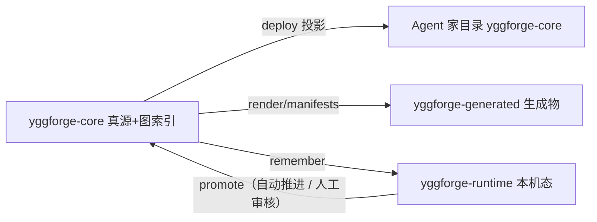
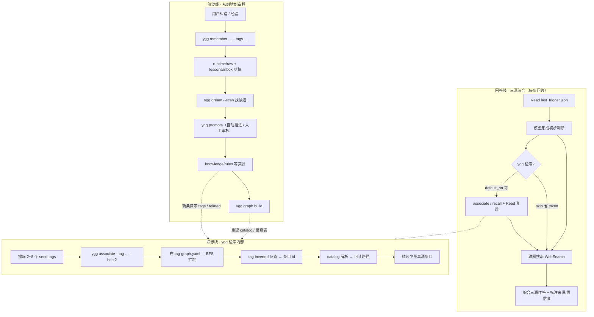

# YggForge

> 给团队和 AI Agent 共用的工程知识库。规范、错题、模板、决策都版本化在 Git 里，多个 Agent 共用同一套，还能按标签联想检索。

## 目录

- [YggForge 是什么](#yggforge-是什么)
- [为什么造它](#为什么造它)
- [它管什么 / 不管什么](#它管什么--不管什么)
- [仓库三层](#仓库三层)
- [记忆与标签（心智模型）](#记忆与标签心智模型)
- [工作原理（端到端）](#工作原理端到端)
- [快速开始](#快速开始)
- [文档地图](#文档地图)
- [License](#license)

---

## YggForge 是什么

一句话：**一个可版本化的工程知识系统，让人和多个 AI Agent 共用同一套规范与经验。**

具体来说，它做三件事：

1. **记** — 把规范、错题、模板、设计决策写成 Markdown + YAML front matter，放进 Git。每条知识有唯一 id、标签、来源、置信度，不跟别的条目糊成一团。
2. **想** — 给一个标签，YggForge 沿着标签关系图扩跳，找出所有相关条目。不是关键词匹配，是"想到 A 联想到 B"那种联想。
3. **思** — Agent 在对话里记下的纠错和经验，先落草稿；晋升为正式规范时，强规范（`rules/`）必须人审，客观知识（`reference/`）与经验（`lessons/`）可设自动。AI 可以提议，人拍板强规范。

记是录所学，想是联贯通，思是反思沉淀——三者缺一不可。

它不是一个被动档案馆，也不是一个博客归档。它有根系（标签图）、能演化（晋升门禁）、可投影（同一真源部署到 Cursor / Codex / OpenCode / Claude / OpenClaw）。

---

## 为什么造它

工程团队用 AI Agent 越来越多，但有个痛点：Agent 每次对话都从零开始，你纠正过的东西它下次又犯。你写过的规范它不知道，你踩过的坑它再踩一遍。

把对话总结堆进一个文件夹？那只是"存了"，没有"用起来"——Agent 不知道哪条相关，也不知道什么能当规范、什么只是临时经验。

YggForge 的选择：

| 原则 | 说人话 |
| --- | --- |
| **真源在 Git** | Markdown / YAML 进仓库，生成物可丢可重建，密钥不进仓 |
| **分层而非堆栈** | rules / templates / lessons / reference / decisions / sources / plugins 各管各的，不混在一起 |
| **晋升门禁** | 草稿可以随便长；进 `rules/`（强规范）必须人审，进 `reference/`（客观知识）或 `lessons/`（经验）可设自动 |
| **轻量默认能跑** | 不需要向量库、不需要 Docker；Python 3 标准库即可跑核心 CLI。可选安装 PyYAML 以完整读写 tag-graph / behavior YAML；增强能力可关 |
| **投影而非绑定** | 同一份真源，投影到 Cursor / Codex / OpenCode / Claude / OpenClaw，不绑定某一个 Agent |
| **联想是图，不是关键词堆** | 标签之间有关系（带权重），查一个标签能扩跳到相关的；像人脑"想到 A 就想到 B" |

### 命名：Yggdrasil × Forge

**Ygg** 取自北欧神话的 **Yggdrasil**（世界树）——一棵根系穿透并连接九个世界的巨树。这里借用的是"连接多界的根系"这层意象：一份真源，连接多个 Agent、多个项目、多个知识层。神话里命运三女神每天用泉水浇灌树根维持树的生机，对应到 YggForge 就是 `graph build`、`promote`、`last_reviewed` 这些持续维护——知识不是堆进去就完了，得养着。

还有个更深的典故：传说奥丁曾倒挂在世界树上九天九夜，以献祭的代价换取智慧。这点出一个被很多知识系统忽略的事实——**知识不是免费的**。你要付出人审门禁、元数据维护、标签图保养的代价，才能得到"可用的智慧"。YggForge 把这个代价显式化：晋升要门禁，条目要 id / tags / 来源 / 置信度，不是 Agent 随便写一句就进库。

**Forge** 是锻造。锻造不是"收集"，是"加工"——把矿石锻成可用的工具。原料（草稿）进熔炉（`distill` / `dream`），上铁砧（`promote` 门禁），由人 + AI 协作锻成成品（可被检索复用的条目）。锻造可复现，所以 YggForge 的索引丢了能 `ygg graph build` 重建，真源一直在 Git 里。

合在一起：**以世界树的根系连接多界，以锻造的工序把原料变成可复用的工程资产。**

### 几个核心设计选择

上面的原则表讲的是"做什么"，这里讲几句"为什么这么选"——这些选择是有意对抗主流方案的：

**为什么用文本（Markdown + YAML）存知识，而不是向量库？** 因为知识的寿命应该长于创造它的工具。向量库的 embedding 3-5 年随模型迭代就失效了，数据库格式会随版本迁移损坏，而纯文本 30 年后任何编辑器都能打开。更重要的是，强规范必须人审——人没法 review 一个 1536 维的浮点数组，所以"人审门禁"的前提就是文本化。默认还不需要 Docker、GPU、embedding 服务，Python 3 + Git 就能跑。

**为什么用标签 BFS 联想，而不是关键词搜索或向量 RAG？** 因为人脑回忆不是跑全文搜索，是"想到 A 联想到 B"——认知科学叫激活扩散（Spreading Activation）。`tag-graph.yaml` 就是这张语义网络，BFS 扩跳就是"想到一层再想到下一层"。它比向量多了三样东西：**可解释**（每条命中带 `via_tags` 和 `tag_hop`，你能看到为什么命中）、**人可控**（拓扑自动维护，人可方便地修改完善，而非向量那样模型生成、人难干预）、**抗噪声**（靠语义结构走，不被高频词淹没）。也不用"多层记忆"那种写入时钉死层级的设计——层级该在查询时涌现，不该在写入时猜死（详见 [docs/concepts/philosophy.md](docs/concepts/philosophy.md) §3.7）。

**为什么单仓库、多投影，而不是给每个 Agent 复制一份？** 因为副本会漂移——你在 Cursor 里改了，Codex 里还是旧的。YggForge 只存一份真源，用 `link`（symlink/junction）把投影指向仓库：改了真源即刻生效，Agent 的修改也自动落回仓库，零拷贝、零漂移。一份真源喂 Cursor / Codex / OpenCode / Claude / OpenClaw，随时换工具不丢知识。

还有两个不那么显眼但很关键的取舍：**制度分层（rules/lessons/reference/templates/decisions 目录）和联想分层（tag 图）是正交的两个维度**——目录管"多严的规矩、多重的审核"，tag 图管"想到 X 联想到哪些"，互不绑架；以及**晋升门禁把"记一笔"和"立规矩"分开**——AI 可以记录、整理、提议，但强规范（rules）必须人审，`dream` 只出报告不自动动手，防止 AI 静默改你的章程。

值得一提的是，这些设计不是凭直觉拍脑袋——`remember → dream → promote` 的沉淀管线在计算层面同构于人脑的记忆系统巩固模型（海马体编码 → 睡眠重放标记候选 → 选择性转移到新皮层），`associate` 的 BFS 同构于认知科学的激活扩散模型。YggForge 站在认知科学的肩膀上：它的核心管线在计算层面同构于经过数十年实验验证的人类记忆模型。详见 [docs/concepts/philosophy.md](docs/concepts/philosophy.md) §7。

审美上有个偏好：**短文档、可导航索引、元数据完整、少长篇单文件。** 宁可多放一个当导航索引用的 README，也不把规范堆成没人维护的巨石。

命名意图与设计哲学的完整阐述见 [docs/concepts/philosophy.md](docs/concepts/philosophy.md)；工程实现见 [docs/concepts/design.md](docs/concepts/design.md)、[docs/concepts/memory-and-association.md](docs/concepts/memory-and-association.md)。

---

## 它管什么 / 不管什么

**管：** 团队规范、错题本、模板、设计决策怎么版本化，怎么让多个 Agent 共用同一套，怎么按标签联想检索。

**不管：** 跨会话"越用越懂你"的个性化记忆、百万文档的全局 GraphRAG。那些可以叠加上来，但别拿它们的 KPI 来替换这个仓库的使命——它不是干那个的。

选型对比见 [docs/assessments/oss-comparison.md](docs/assessments/oss-comparison.md)。

---

## 仓库三层

```text
YggForge/
├── docs/                 # 人类文档（本说明的细则）
├── yggforge-core/        # 真源：knowledge / profiles / scripts / graph(含机器索引) / config
├── yggforge-generated/   # 可再生产物：rendered/imports/manifests、可选 indexes、scratch
└── yggforge-runtime/     # 本机态：记忆 raw、*.local.json、cache
```

三层各管各的：`yggforge-core` 是真源 + 图机器索引（进 Git，随核心包部署），`yggforge-generated` 是本机可再生产物（可重建），`yggforge-runtime` 是本机状态（不入库）。



布局细则见 [docs/concepts/layout.md](docs/concepts/layout.md)。

---

## 记忆与标签（心智模型）

YggForge 的联想靠标签，不靠向量。理解这个模型很重要：

- 正文（规则、经验等）每个文件带 YAML front matter。索引必填：`id`、`title`、`status`、**`type`**（`rule` / `lesson` / `decision` / `template` / `source` / `distilled-source` / `reference` / `skill` / `mcp-server` / `hook`）；另有 `tags`、`related`、`scope` 等。结构化元数据进 YAML，叙述留正文。权威约定：`yggforge-core/schemas/knowledge-item.schema.yaml`（v2）
- **标签邻接图** `yggforge-core/graph/tag-graph.yaml`：标签和标签之间的关系（可带权重），自动维护、人可方便干预（`graph build` 扫 front matter 生成反查表，`tag --suggest` 自动建议边；人可手改 YAML）
- **机器索引**（`ygg graph build` 生成，可重建）：
  - `catalog`：条目 id → 路径 / 标题 / tags / related（正查：知道 id 找条目；TSV 列名 `kind` 存的是 front matter **`type` 的值**）
  - `tag-inverted`：标签 → 条目 id 列表（反查：知道标签找条目）
- 索引按大小/行数**自动有序分片**，单文件不会塞爆；查询时先定位分片再二分

一句话：front matter 的 `tags` 是正向（条目→标签），`tag-inverted` 是反向（标签→条目）。联想时给一个标签，一步查出哪些条目带它。

图示与完整说明见 [docs/concepts/memory-and-association.md](docs/concepts/memory-and-association.md)。

---

## 工作原理（端到端）

YggForge 运行时有三条主线：**联想**（从问题想到相关知识）、**综合回答**（三源作答）和 **沉淀**（从纠错升为章程）。沉淀通过 `ygg graph build` 闭环进入下一次联想；回答则始终综合模型推理、ygg 检索与联网搜索（真源 `knowledge/rules/standing-preference.md`）。



**联想 + 综合回答长什么样：**

你问「拿铁和卡布奇诺的奶泡有啥区别」→ 钩子落盘 `default_on` → **模型先有基本判断** → 提炼 seed tags `coffee`、`latte` → `ygg associate --tag coffee --tag latte --hop 2` → 命中 `knowledge/reference/coffee-demo/...latte-vs-cappuccino-奶泡厚度.md` 等 → **WebSearch 交叉验证**（SCA 标准、现代咖啡馆做法）→ **综合三源**作答：「拿铁奶多微泡薄，卡布奇诺奶泡厚而干（约 1:1:1）」，并标注 ygg reference / 联网 / 模型推理各自来源。

**记忆长什么样：**

你分享「浓缩咖啡默认 1:2，18g 进 36g 出，93°C，25-30 秒」→ 跑 `ygg remember "浓缩咖啡 18g 进 36g 出 93°C 1:2 25-30 秒" --tags coffee espresso brewing --title "浓缩咖啡萃取参数"` → 草稿落到 `lessons/inbox/` → `ygg dream --scan` 标为晋升候选 → `ygg promote <entry> reference`（客观知识自动推进 / 人工审核）→ `ygg graph build` 让它进入下次联想（之后 `ygg associate --tag coffee` 就能命中它）。

> 这组咖啡条目已作为教学示例真实存放在仓库里（`knowledge/reference/coffee-demo/20260722-*`，`scope: demo`）。你可以自己跑一下验证：

```bash
ygg associate --tag coffee --hop 2
```

应该看到 4 条命中（espresso / cappuccino / latte / pour-over），每条带 via_tags 和 tag_hop。

**关键边界：** `dream` 只出报告；`promote` 到 `rule`（强规范）必须人审，到 `reference`（客观知识）/ `lesson`（经验）可设自动——AI 可以记录、整理、提议，但不能把草稿静默变成强规范。

**客观知识例外：** 纯客观知识/信息（参数表、事实记录等）可走 `ygg promote reference --entry <draft> --auto --objective` 自动晋升。脚本会自动跑标签联想查重防雷同（有雷同就跳过为 `duplicate_candidate`）。`promote.auto_to_reference` 默认 `allow`。但 rules 仍严格——`auto_to_rule` 默认 deny，强规范永远要人审。

细节机制（扩跳算法、有序分片、晋升门禁）见 [docs/concepts/memory-and-association.md](docs/concepts/memory-and-association.md)。

---

## 快速开始

### 你需要什么

- Git
- Python 3（3.7+；标准库即可。可选：`pip install pyyaml`）
- Windows 用 PowerShell，Linux/macOS 用 Bash

### 部署到 Agent（以 Cursor 为例）

```powershell
# Windows / PowerShell，在仓库根目录
.\ygg.ps1 deploy link cursor
```

```bash
# Linux / macOS，在仓库根目录
./ygg.sh deploy link cursor
```

`link` 模式优先（目录用 junction；单文件在 Windows 上可能因跨盘或无 symlink 特权而退化为 **copy**——见下）。

部署完你会看到类似输出：

```text
[cursor] action=deploy mode=link
  enabled : True
  mapping : yggforge_core
    junction: ~/.cursor/yggforge-core
  mapping : hooks
    junction: ~/.cursor/hooks
  mapping : hooks_config
    copied  : ~/.cursor/hooks.json
```

说明：

- `junction` / `linked` / `hardlink`：改仓库真源后 Agent 侧**立即**生效。
- `copied`：内容已同步，但**不会**随仓库自动更新；改 `hooks.windows.json` 后需删掉 `~/.cursor/hooks.json` 再重跑 `ygg deploy link cursor`。Windows 跨盘（如 E: 仓库 + C: 用户目录）或无 Developer Mode 时，`hooks.json` 常会显示 `copied`。
- Cursor **用户级不再投影** `AGENTS.md` 与 `rules/`（原生不加载全局 `~/.cursor/AGENTS.md`、`~/.cursor/rules/`）。规则与项目入口请用项目级部署 `ygg deploy --scope project --project-root <repo> cursor`（投影到 `<repo>/.cursor/rules/*.mdc`，Cursor 自动加载）。详见 [docs/guide/deploy.md](docs/guide/deploy.md)。

行为策略（是否部署后 git sync、记忆写入是否每次问等）见 [docs/reference/behavior-config.md](docs/reference/behavior-config.md)。

更完整的步骤：[quickstart](docs/guide/quickstart.md) · [install](docs/guide/install.md) · [deploy](docs/guide/deploy.md)。

### 日常命令

| 想做什么 | 命令 |
| --- | --- |
| 看状态 | `ygg status` |
| 记住一条 | `ygg remember …` |
| 按标签联想检索 | `ygg associate --tag …` |
| 按关键词检索 | `ygg recall …` |
| 扫描待晋升候选 | `ygg dream` |
| 晋升草稿 | `ygg promote lesson\|rule\|template …` |
| 重建图索引 | `ygg graph build` |
| 多机同步 | `ygg sync` / `ygg push`（受 behavior 闸门） |
| 看当前策略 | `ygg behavior` |

CLI 与触发词：[ygg-cli.md](docs/reference/ygg-cli.md) · [triggers.md](docs/reference/triggers.md) · [usage.md](docs/guide/usage.md)。

部署如果失败，**直接把报错和这个仓库交给 AI 排查**——最常见的坑是路径、权限、junction 和 `*.local.json` 配置，比脚本本身更容易出问题。

---

## 文档地图

| 想看什么 | 去哪 |
| --- | --- |
| 总索引 | [docs/README.md](docs/README.md) |
| 入门指南 | [docs/guide/](docs/guide/quickstart.md) |
| 理念与结构 | [docs/concepts/](docs/concepts/design.md) |
| 命令与配置 | [docs/reference/](docs/reference/ygg-cli.md) |
| 后续优化建议 | [docs/opt-plan/](docs/opt-plan/README.md) |
| 选型评估 | [docs/assessments/](docs/assessments/README.md) |

---

## License

采用 **PolyForm Noncommercial 1.0.0**（SPDX：`PolyForm-Noncommercial-1.0.0`）：个人 / 非商业用途免费，商用须另购授权。

- 许可正文：[LICENSE](LICENSE)
- 商用授权说明：[COMMERCIAL.md](COMMERCIAL.md)
- 选型背景与 FAQ：[docs/reference/licensing.md](docs/reference/licensing.md)

> ⚠️ GitHub 仓库 License 字段请手动设为 **Other**：PolyForm Noncommercial 不在 GitHub 标准列表里，误标 MIT/Apache 会被当作可免费商用。详见 [licensing.md 检查清单](docs/reference/licensing.md#github-上架检查清单)。

Copyright © 2026 [leoknuth](https://github.com/leoknuth)
