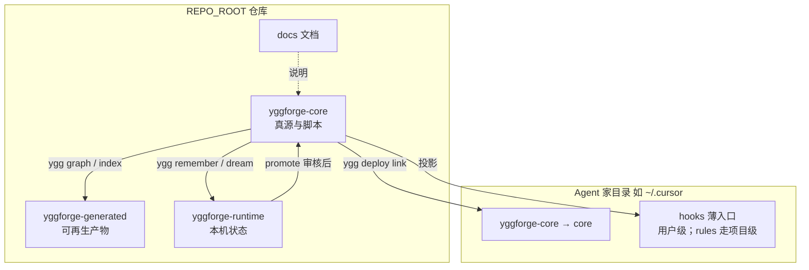
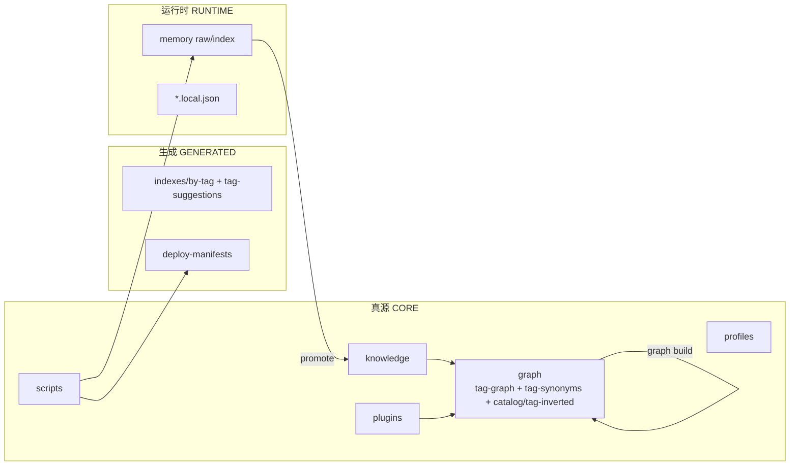

# 目录层级与模块边界

## 目录

- [1. 设计原则](#1-设计原则)
- [2. 仓库内三层（开发态）](#2-仓库内三层开发态)
- [3. 部署后布局（Agent 家目录）](#3-部署后布局agent-家目录)
- [4. 三层关系图](#4-三层关系图)
- [5. 数据流与写入落点](#5-数据流与写入落点)
- [6. 路径常量](#6-路径常量)

---

## 1. 设计原则

用**目录名本身**表达模块职责，避免把「真源 / 生成物 / 本机状态」混在同一棵可部署树里：

| 目录 | 角色 | 是否进 git | 是否部署到 Agent |
| --- | --- | --- | --- |
| `yggforge-core/` | 可版本化产品真源（知识、投影、脚本、图索引、默认可提交配置） | **是** | **是**（整包 → `yggforge-core/`） |
| `yggforge-generated/` | 可再生产物（部署清单、rendered/imports、可选导览、scratch） | 仅 README | 否 |
| `yggforge-runtime/` | 本机可变状态（记忆 raw/index、`*.local.json`、cache） | 仅 README | 否 |
| `docs/` | 人类设计与使用文档 | 是 | 否 |

`yggforge-core` **不应**再把「忽略名单」写进仓库根 `.gitignore`；需要忽略的内容迁出到 generated / runtime。

---

## 2. 仓库内三层（开发态）

```text
YggForge/                              # REPO_ROOT
├── docs/                              # 人类文档
├── AGENTS.md / README.md
├── ygg.sh / ygg.ps1                   # CLI 薄包装
├── .agents/skills/                    # 可选：仓内 Cursor 第三方/工具技能（非 YggForge 插件投影）
│
├── yggforge-core/                     # CORE_ROOT · 可部署产品
│   ├── knowledge/                     # 知识真源（rules/templates/lessons/reference/…）
│   ├── plugins/                       # 可部署能力包（skills/mcp-servers/hooks/rules）正文
│   ├── profiles/                      # 各 Agent 投影入口（含 cursor/rules、cursor/skills stub）
│   ├── scripts/                       # CLI 与自动化（内部结构见 scripts/README.md）
│   ├── config/                        # 默认可提交配置（*.defaults.json / channels 等）
│   ├── graph/
│   │   ├── tag-graph.yaml             # 可编辑的 tag 邻接权威
│   │   ├── tag-synonyms.yaml          # 同义词归并与 tag 规范语言
│   │   ├── catalog/                   # 机器索引（ygg graph build，随核心包部署）
│   │   └── tag-inverted/
│   └── schemas/
│
├── yggforge-generated/                # GENERATED_ROOT · 可再生产物
│   ├── deploy-manifests/
│   ├── rendered/
│   ├── imports/
│   ├── indexes/
│   │   ├── by-tag/                    # 可选 ygg index
│   │   └── tag-suggestions.json       # ygg tag --suggest（可再生）
│   └── scratch/                       # .tmp-*、实验解压等
│
└── yggforge-runtime/                  # RUNTIME_ROOT · 本机状态
    ├── memory/raw/
    ├── memory/index/
    ├── cache/
    └── config/                        # *.local.json 本机覆盖
```

---

## 3. 部署后布局（Agent 家目录）

以 Cursor 为例（Codex / OpenCode / Claude / OpenClaw 同理，家目录不同）：

### 用户级（`ygg deploy link cursor`，默认 `--scope user`）

```text
~/.cursor/
├── yggforge-core/                 → <REPO>/yggforge-core     # 整包核心（link/junction）
│   ├── knowledge/
│   ├── plugins/
│   ├── profiles/
│   ├── scripts/
│   ├── config/               # 仅 defaults；本机覆盖仍在仓库 runtime
│   └── graph/                # catalog/tag-inverted 随核心包部署，使 associate 部署后可命中
└── hooks/                    → yggforge-core/profiles/cursor/hooks   # 用户级强制钩子（官方支持）
    + hooks.json              → yggforge-core/profiles/cursor/hooks.windows.json
```

> **Cursor 限制**：用户级**不**投影 `AGENTS.md` 与 `rules/`（Cursor 原生不加载全局
> `~/.cursor/AGENTS.md` 与 `~/.cursor/rules/`）。规则与项目入口请用项目级部署。

### 项目级（`ygg deploy --scope project --project-root <repo> cursor`）

```text
<repo>/.cursor/
├── rules/                    → yggforge-core/profiles/cursor/rules      # *.mdc（Cursor 自动加载项目级 rules）
└── hooks/                    → yggforge-core/profiles/cursor/hooks
    + hooks.json
```

说明：

- Agent 日常读到的规范/入口在 `~/.<agent>/yggforge-core/`（及薄入口）。
- `ygg remember` / `ygg graph build` 等 CLI **仍在仓库侧**写入 `yggforge-runtime/`；`ygg graph build` 的机器索引写入 `yggforge-core/graph/`（随核心包部署，使 associate 部署后可命中），其余可再生产物进 `yggforge-generated/`，不会把运行时垃圾部署进 Agent 家目录。

---

## 4. 三层关系图



模块职责对照：



---

## 5. 数据流与写入落点

| 操作 | 主要写入 |
| --- | --- |
| 人工编辑规范/模板 | `yggforge-core/knowledge/` |
| 人工编辑技能/MCP/钩子/规则包 | `yggforge-core/plugins/` |
| 编辑 tag 邻接 | `yggforge-core/graph/tag-graph.yaml` |
| 编辑 tag 同义词 | `yggforge-core/graph/tag-synonyms.yaml` |
| `ygg remember` | `yggforge-runtime/memory/raw/` + 可选 `knowledge/lessons/inbox/` |
| `ygg dream` | `yggforge-runtime/memory/index/` |
| `ygg promote` | `yggforge-core/knowledge/...` |
| `ygg graph build` | `yggforge-core/graph/{catalog,tag-inverted}/` |
| `ygg tag --suggest` | `yggforge-generated/indexes/tag-suggestions.json` |
| `ygg index` | `yggforge-generated/indexes/by-tag/` |
| `ygg deploy` | Agent 家目录 + `yggforge-generated/deploy-manifests/` |
| 本机路径覆盖 | `yggforge-runtime/config/*.local.json` |
| 临时实验 / `.tmp-*` | `yggforge-generated/scratch/` |

---

## 6. 路径常量

脚本统一从 `yggforge-core/scripts/lib/repo_paths.py` 解析：

- `CORE_ROOT` → `yggforge-core/`
- `GENERATED_ROOT` → `yggforge-generated/`
- `RUNTIME_ROOT` → `yggforge-runtime/`
- `REPO_ROOT` → 含 `.git` 的仓库根

相关文档：

- [deploy.md](../guide/deploy.md)
- [memory-and-association.md](memory-and-association.md)
- [sync-boundaries.md](sync-boundaries.md)
- [../yggforge-core/README.md](../../yggforge-core/README.md)
- [../yggforge-generated/README.md](../../yggforge-generated/README.md)
- [../yggforge-runtime/README.md](../../yggforge-runtime/README.md)
