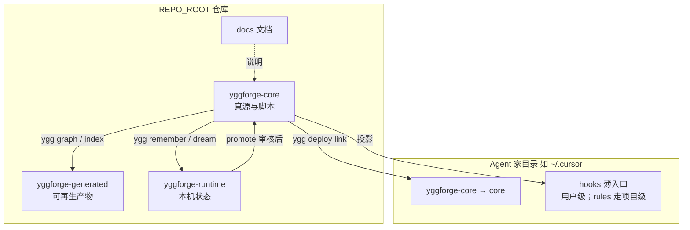
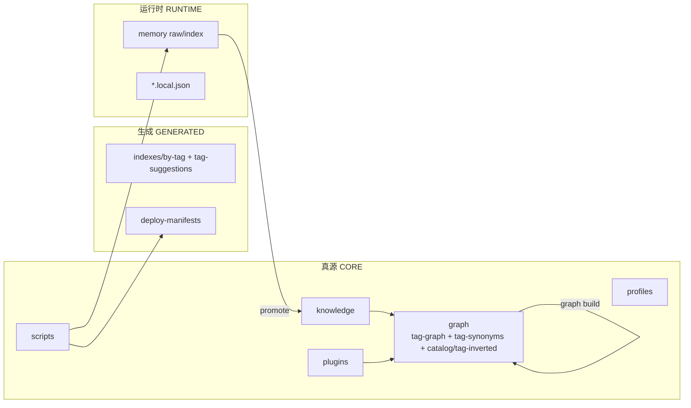

# 目录层级与模块边界

## 目录

- [1. 设计原则](#1-设计原则)
- [2. 仓库内三层（开发态）](#2-仓库内三层开发态)
- [3. 部署后布局（Agent 家目录）](#3-部署后布局agent-家目录)
- [4. 三层关系图](#4-三层关系图)
- [5. 数据流与写入落点](#5-数据流与写入落点)
- [6. 路径常量](#6-路径常量)

---

## 1. 设计原则

用**目录名本身**表达模块职责，避免把「真源 / 生成物 / 本机状态」混在同一棵可部署树里：

| 目录 | 角色 | 是否进 git | 是否部署到 Agent |
| --- | --- | --- | --- |
| `yggforge-core/` | 可版本化产品真源（知识、投影、脚本、图索引、默认可提交配置） | **是** | **是**（整包 → `yggforge-core/`） |
| `yggforge-generated/` | 可再生产物（部署清单、rendered/imports、可选导览、scratch） | README 与 .gitignore | 否 |
| `yggforge-runtime/` | 本机可变状态（记忆 raw/index、`*.local.json`、cache） | README 与 .gitignore | 否 |
| `docs/` | 人类设计与使用文档 | 是 | 否 |

`yggforge-core` **不应**再把「忽略名单」写进仓库根 `.gitignore`；需要忽略的内容迁出到 generated / runtime。

---

## 2. 仓库内三层（开发态）

```text
YggForge/
├── .git/                         [本地] Git 对象、索引、SSH 远端配置
├── .github/                      [Git] GitHub CI 配置
├── .agents/skills/               [混合] 指定内置技能进 Git，安装产物留本地
├── docs/                         [Git] 设计、部署、使用和接口文档
├── tests/                        [Git] 回归验证
├── AGENTS.md / README.md         [Git] 仓库维护约定与总入口
├── ygg.ps1 / ygg.sh              [Git] CLI 包装
├── .editorconfig/.gitattributes  [Git] 编码、换行与 Git 文本规范
├── .gitignore / 许可与 CI 文件  [Git] 忽略边界、许可、构建配置
│
├── yggforge-core/               [Git] 可部署真源
│   ├── config/                  [Git] 默认配置，不含本机秘密
│   ├── schemas/                 [Git] 配置和知识元数据校验
│   ├── knowledge/               [Git] 知识真源
│   │   ├── rules/               稳定约定
│   │   ├── templates/           可复用模板
│   │   ├── lessons/inbox/       记忆草稿与待晋升经验
│   │   ├── reference/           参考资料
│   │   ├── decisions/           已记录决策
│   │   └── sources/             来源材料及提炼结果
│   ├── plugins/                 [Git] Ygg 技能、hooks、规则和 MCP 定义
│   ├── profiles/                [Git] Codex、Cursor 等工具投影
│   ├── scripts/                 [Git] CLI 路由、存储、检索、部署和策略
│   ├── graph/                   [Git] 标签图及随核心部署的机器索引
│   │   ├── tag-graph.yaml       标签关系权威
│   │   ├── tag-synonyms.yaml    同义词与标准标签
│   │   ├── catalog/             条目机器索引，可重建但进 Git
│   │   └── tag-inverted/        标签倒排索引，可重建但进 Git
│   └── roles/                   [规划·Git] 角色真源，尚未创建实际角色
│       ├── finance-expert/
│       │   ├── role.yaml        固定身份、职责与技能选择
│       │   ├── AGENTS.md         工作约定
│       │   ├── IDENTITY.md       身份与个性
│       │   ├── skills/           独有技能、共享技能引用
│       │   └── memories/         [规划·私有 Git] 长期记忆
│       │       ├── notes/        事实、偏好、纠错与案例记录
│       │       └── summary.md    启动用短摘要
│       └── legal-expert/         [规划·私有 Git] 法律专家
│           ├── role.yaml
│           ├── AGENTS.md
│           ├── IDENTITY.md
│           ├── skills/
│           └── memories/
│               ├── notes/
│               └── summary.md
│
├── yggforge-runtime/            [本地] README/.gitignore 例外进 Git
│   ├── memory/raw/              一般 Ygg 原始记忆
│   ├── memory/index/            一般记忆派生索引
│   ├── privacy/                 本地隐私与发布判定记录
│   ├── backups/                 本地运行备份
│   ├── hosts/<host-id>/          Windows 与 WSL 各自的机器状态
│   │   ├── config/              本机路径、工具连接与 local 配置
│   │   └── cache/               hooks、会话触发结果等缓存
│   └── roles/<role-id>/          [规划·本地] sessions/index/cache/locks
│
└── yggforge-generated/          [本地] README/.gitignore 例外进 Git
    └── hosts/<host-id>/          各宿主的可再生产物
        ├── deploy-manifests/    部署收据与 import 基线
        ├── rendered/           渲染入口
        ├── imports/            导入复核暂存
        ├── indexes/            可选导览与标签建议
        ├── scratch/            临时分析文件
        └── roles/<role-id>/     [规划·本地] 角色入口和技能投影
```

---


角色目录是后续设计示意，当前角色功能尚未实现。长期角色记忆与临时运行数据分层；角色记忆固定排除公共框架发布，见 [发布边界](publication-boundary.md)。

## 3. 部署后布局（Agent 家目录）

以 Cursor 为例（Codex / OpenCode / Claude / OpenClaw 同理，家目录不同）：

### 用户级（`ygg deploy link cursor`，默认 `--scope user`）

```text
~/.cursor/
├── yggforge-core/                 → <REPO>/yggforge-core     # 整包核心（link/junction）
│   ├── knowledge/
│   ├── plugins/
│   ├── profiles/
│   ├── scripts/
│   ├── config/               # 仅 defaults；本机覆盖仍在仓库 runtime
│   └── graph/                # catalog/tag-inverted 随核心包部署，使 associate 部署后可命中
└── hooks/                    → yggforge-core/profiles/cursor/hooks   # 用户级强制钩子（官方支持）
    + hooks.json              → yggforge-core/profiles/cursor/hooks.windows.json
```

> **Cursor 限制**：用户级**不**投影 `AGENTS.md` 与 `rules/`（Cursor 原生不加载全局
> `~/.cursor/AGENTS.md` 与 `~/.cursor/rules/`）。规则与项目入口请用项目级部署。

### 项目级（`ygg deploy --scope project --project-root <repo> cursor`）

```text
<repo>/.cursor/
├── rules/                    → yggforge-core/profiles/cursor/rules      # *.mdc（Cursor 自动加载项目级 rules）
└── hooks/                    → yggforge-core/profiles/cursor/hooks
    + hooks.json
```

说明：

- Agent 日常读到的规范/入口在 `~/.<agent>/yggforge-core/`（及薄入口）。
- `ygg remember` / `ygg graph build` 等 CLI **仍在仓库侧**写入 `yggforge-runtime/`；`ygg graph build` 的机器索引写入 `yggforge-core/graph/`（随核心包部署，使 associate 部署后可命中），其余可再生产物进 `yggforge-generated/`，不会把运行时垃圾部署进 Agent 家目录。

---

## 4. 三层关系图



模块职责对照：



---

## 5. 数据流与写入落点

| 操作 | 主要写入 |
| --- | --- |
| 人工编辑规范/模板 | `yggforge-core/knowledge/` |
| 人工编辑技能/MCP/钩子/规则包 | `yggforge-core/plugins/` |
| 编辑 tag 邻接 | `yggforge-core/graph/tag-graph.yaml` |
| 编辑 tag 同义词 | `yggforge-core/graph/tag-synonyms.yaml` |
| `ygg remember` | `yggforge-runtime/memory/raw/` + 可选 `knowledge/lessons/inbox/` |
| `ygg dream` | `yggforge-runtime/memory/index/` |
| `ygg promote` | `yggforge-core/knowledge/...` |
| `ygg graph build` | `yggforge-core/graph/{catalog,tag-inverted}/` |
| `ygg tag --suggest` | `yggforge-generated/hosts/<host-id>/indexes/tag-suggestions.json` |
| `ygg index` | `yggforge-generated/hosts/<host-id>/indexes/by-tag/` |
| `ygg deploy` | Agent 家目录 + `yggforge-generated/hosts/<host-id>/deploy-manifests/` |
| 本机路径覆盖 | `yggforge-runtime/hosts/<host-id>/config/*.local.json` |
| 临时实验 / `.tmp-*` | `yggforge-generated/hosts/<host-id>/scratch/` |

---

## 6. 路径常量

脚本统一从 `yggforge-core/scripts/lib/repo_paths.py` 解析：

- `CORE_ROOT` → `yggforge-core/`
- `GENERATED_ROOT` → `yggforge-generated/`
- `RUNTIME_ROOT` → `yggforge-runtime/`
- `REPO_ROOT` → 含 `.git` 的仓库根
- `HOST_RUNTIME_ROOT` → `yggforge-runtime/hosts/<host-id>/`，本机配置与缓存
- `HOST_GENERATED_ROOT` → `yggforge-generated/hosts/<host-id>/`，部署、导入与渲染产物

相关文档：

- [deploy.md](../guide/deploy.md)
- [memory-and-association.md](memory-and-association.md)
- [sync-boundaries.md](sync-boundaries.md)
- [../yggforge-core/README.md](../../yggforge-core/README.md)
- [../yggforge-generated/README.md](../../yggforge-generated/README.md)
- [../yggforge-runtime/README.md](../../yggforge-runtime/README.md)
