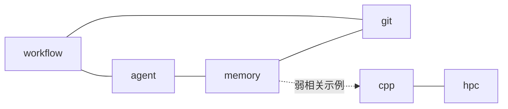
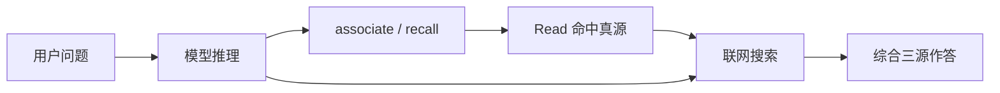

# 记忆、联想与知识沉淀

> 本文把「联想机制 / 知识沉淀过程 / 存储形态」收成一篇总览。细节仍以文末「权威来源」为准。  
> 文中若写 `knowledge/`、`graph/`、`profiles/` 且未写 `yggforge-core/` 前缀，均指 **CORE_ROOT**（`yggforge-core/`）下路径。

## 目录

- [1. 先分清两层](#1-先分清两层)
- [2. 知识与记忆的存储形态](#2-知识与记忆的存储形态)
  - [2.1 Canonical 知识（真源）](#21-canonical-知识真源)
  - [2.2 运行时记忆（草稿与 observation）](#22-运行时记忆草稿与-observation)
  - [2.3 联想索引（可重建）](#23-联想索引可重建)
  - [2.4 存储总表](#24-存储总表)
- [3. 联想过程与内部机制](#3-联想过程与内部机制)
  - [3.1 两类「联想」并行](#31-两类联想并行)
  - [3.2 associate 管线（可审计）](#32-associate-管线可审计)
    - [3.2.1 走例：一次 associate](#321-走例一次-associate)
  - [3.3 与 recall 的分工](#33-与-recall-的分工)
  - [3.4 配置与实现入口](#34-配置与实现入口)
- [4. 知识沉淀的具体过程](#4-知识沉淀的具体过程)
  - [4.1 端到端闭环](#41-端到端闭环)
    - [4.1.1 走例：一次 remember 到 promote](#411-走例一次-remember-到-promote)
  - [4.2 三条入口如何汇流](#42-三条入口如何汇流)
  - [4.3 晋升门禁与落点](#43-晋升门禁与落点)
  - [4.4 沉淀后如何进入联想](#44-沉淀后如何进入联想)
- [5. Agent 日常应怎么用](#5-agent-日常应怎么用)
- [6. 权威来源与源码](#6-权威来源与源码)

---

## 1. 先分清两层

`YggForge` 故意把「记一笔」和「立规矩」分开：

| 层 | 角色 | 默认是否进强规范 | 典型路径 |
| --- | --- | --- | --- |
| **运行时记忆** | 当日观察、纠错草稿、consolidation 报告 | 否 | `yggforge-runtime/memory/`、`yggforge-core/knowledge/lessons/inbox/` |
| **Canonical 知识** | 可复用的规则 / 模板 / 经验 / 决策 / 来源 | 是（正式条目） | `yggforge-core/knowledge/{rules,templates,lessons,decisions,sources}/` |

另外还有两层与 `yggforge-core/knowledge/` 解耦的目录：

- `yggforge-core/graph/`：联想用机器索引（可修改的 `tag-graph.yaml` + 生成 catalog / tag-inverted），**不在** `knowledge/` 内
- `yggforge-generated/indexes/`：可选人类 by-tag 导览（需主动 `ygg index`；可提交；含 `EXPORT_META` 时间与 commit）

一句话：

- **Markdown 正文** = 人类与 Agent 共同维护的记忆/知识内容  
- **图索引 TSV** = 为联想加速的登记表（`ygg graph build` 生成）  
- **运行时 raw** = 尚未晋升的 observation

---

## 2. 知识与记忆的存储形态

### 2.1 Canonical 知识（真源）

形式：Git 仓库内的 **Markdown + YAML front matter**（文本文件，UTF-8 with BOM；单文件，不拆 sidecar）。字段约定见 `yggforge-core/schemas/knowledge-item.schema.yaml`（v2：必填 `type`，公共字段 + type 专有字段；结构化元数据进 YAML，叙述留正文）。统一解析 `scripts/lib/front_matter.py`；`ygg graph check` 会跑 schema 校验。需要 Cursor `alwaysApply` 时真源仍为 `.md`，用 `ygg project mdc` 投影到 `profiles/cursor/rules/*.mdc`。

常见字段（正式条目建议补齐）：

- `id`：算法生成的全局 id（`{时间14}-{目录首字母6}-{标题词首8}-{随机4}`）
- `title` / `status` / `tags` / `keywords` / `priority` / `scope` / `agent_targets`
- `related`：直接关联的其他条目 **id**（联想时默认再扩 1 跳）

分层目录（相对 `knowledge/` 深度建议不超过 5）：

| 目录 | 放什么 |
| --- | --- |
| `rules/` | 稳定约束（逻辑层） |
| `templates/` | 可复用 SOP / 实现骨架（技能层之一） |
| `lessons/` | 经验、踩坑、错题（含 `inbox/` 草稿） |
| `decisions/` | 架构取舍（通常人工写入，不走 promote） |
| `sources/inbox`、`sources/distilled` | 外部来源与提炼稿 |

跨 Agent 的短行为包另在：`profiles/common/behavior-packs/`（投影用，不是 `knowledge/` 正文真源，但属于「技能/做法」资产）。

### 2.2 运行时记忆（草稿与 observation）

当前**只实现 `file` backend**（透明、可审计、与 Git 边界清晰）。

| 路径 | 内容 |
| --- | --- |
| `yggforge-runtime/memory/raw/` | `ygg remember` 写下的原始 observation（Markdown/文本） |
| `yggforge-runtime/memory/index/` | 本地索引缓存；`ygg dream` 的 consolidation 报告等 |
| `knowledge/lessons/inbox/` | remember 镜像出的 lesson **草稿**（仍非正式 lesson） |

可选更重后端（sqlite / vector / mcp）见优化计划；运行时边界见 [../../yggforge-runtime/README.md](../../yggforge-runtime/README.md)。

### 2.3 联想索引（可重建）

| 文件 / 目录 | 权威性 | 形态 |
| --- | --- | --- |
| `graph/tag-graph.yaml` | **可修改** | tag↔tag 邻接（可含 `weight`） |
| `yggforge-core/graph/catalog/*.tsv` | 生成 | 按条目 **id** 排序：`id → path/type(列名仍为 kind)/title/tags/related/…` |
| `yggforge-core/graph/tag-inverted/*.tsv` | 生成 | 按 tag 排序：`tag → id\|id\|…`（**只记 id，不嵌正文**） |
| `*/manifest.json` | 生成 | 分片清单与字节/行数阈值 |
| `indexes/by-tag/*.md` | 可选导出（需主动 `ygg index`） | 人类可读 tag 页 |

**映射约定：** tag ↔ 文本记忆的多对多关系，一律通过条目 **`id`** 记录；正文文件本身带 `tags:`（条目→标签，正向），`graph build` 再生成 tag→条目 id 的反查表（倒排索引，标签→条目）。

**自动分片：** `SortedShardStore` 按 `shard_max_bytes` / `shard_max_lines`（见 `graph.defaults.json`）把 catalog / tag-inverted **有序裂变**成多个 TSV，避免单文件塞爆 id 列表；查询先查 `manifest` 定位分片再二分。完整列说明与裂变例子见 [../../yggforge-core/graph/README.md](../../yggforge-core/graph/README.md) §4–§5。

未裂变（小仓常见）：

```text
tag-inverted/_all.tsv
agent<TAB>idA|idB
git<TAB>idB|idD
memory<TAB>idD
```

裂变后（超阈值；按 key 字典序前缀，不是哈希打散）：

```text
tag-inverted/a.tsv     →  agent<TAB>idA|idB
tag-inverted/g.tsv     →  git<TAB>idB|idD
tag-inverted/m.tsv     →  memory<TAB>idD
tag-inverted/manifest.json   # 登记每个分片的 prefix / first_key / last_key
```

catalog 若条目很多，会按 id 时间前缀裂成 `2026.tsv` → `202607.tsv` 等（时间在 id 最前）。

索引**不**替代正文；丢了可 `ygg graph build` 重建。

#### 标签网络（tag ↔ tag）



（边写在 `tag-graph.yaml`；上图为示意，以仓库内 YAML 为准。）

#### 标签 ↔ 文本记忆（经 id 的多对多）

左边一列是 tag，右边一列是记忆条目（用 **id** 代表）；一条边 =「该 tag 的反查表里含该 id」，或等价地「该条目 front matter 的 `tags` 含该 tag」。

```mermaid
flowchart LR
  subgraph Tags
    t_git[git]
    t_mem[memory]
    t_wf[workflow]
    t_cpp[cpp]
  end
  subgraph Entries["文本记忆（按 id）"]
    e1["20260701…-kr$$$$-gwfaa$$$…"]
    e2["20260701…-kr$$$$-mapw$$$$…"]
    e3["20260701…-kl$$$$-ap$$$$$$…"]
    e4["20260701…-kr$$$$-csb$$$$$…"]
  end
  t_git --- e1
  t_git --- e2
  t_mem --- e2
  t_mem --- e3
  t_wf --- e1
  t_wf --- e3
  t_cpp --- e4
```

ASCII 等价（Git 里不渲染 Mermaid 时也能看）：

```text
tags                    entry ids（正文另存 knowledge/**/*.md）
─────                   ─────────────────────────────────────
git          ──┬──────► 20260701…-kr$$$$-gwfaa$$$-…
               └──────► 20260701…-kr$$$$-mapw$$$$-…
memory       ──┬──────► 20260701…-kr$$$$-mapw$$$$-…
               └──────► 20260701…-kl$$$$-ap$$$$$$-…
workflow     ──┬──────► 20260701…-kr$$$$-gwfaa$$$-…
               └──────► 20260701…-kl$$$$-ap$$$$$$-…
cpp          ─────────► 20260701…-kr$$$$-csb$$$$$-…

catalog:        id  →  path, title, tags, related, …
tag-inverted:   tag →  id|id|id|…   （分片 TSV）
```

### 2.4 存储总表

| 资产 | 物理形态 | 是否 Git 真源正文 | 谁写 | 谁读 |
| --- | --- | --- | --- | --- |
| 正式 rule/lesson/… | `.md` + front matter | 是 | 人 / promote / 人工编辑 | Agent、associate、recall |
| lesson 草稿 | `lessons/inbox/*.md` | 草稿区 | remember / 人工 | dream、promote、recall |
| observation | `yggforge-runtime/memory/raw/*` | 通常不作为规范真源 | remember | recall、dream |
| tag 邻接 | `tag-graph.yaml` | 是（图边真源） | 人 / Agent / 程序 | associate |
| catalog / tag 反查表 | 有序 TSV 分片 | 生成物 | graph build | associate |
| by-tag 页 | Markdown 索引 | 可选导出物 | `ygg index` | 人类浏览（非联想真源） |

---

## 3. 联想过程与内部机制

### 3.1 两类「联想」并行

处理任务时推荐：

1. **模型自身联想与推理**（不可审计，但灵活）
2. **知识图联想**（`ygg associate`，可审计、可复现）

二者是组合，不是替代。约定见 [retrieval-conventions.md](retrieval-conventions.md) §9。

### 3.2 associate 管线（可审计）

默认配置见 `config/graph.defaults.json`：`default_hop=2`，`entry_related_hops=1`。

```text
seed tags
   │
   ▼
经 tag-synonyms.yaml 归并到 canonical tag（如 拿铁 → latte）
   │
   ▼
在 tag-graph.yaml 上 BFS 扩跳（最多 hop 级；可受 max_tag_nodes 限制）
   │
   ▼
对每个相关 tag，查 tag-inverted → 条目 id 并集
   │
   ▼
（可选）对命中条目的 related 再扩 entry_related_hops 跳（默认 1）
   │
   ▼
用 catalog 把 id 解析为 path / type（列名 `kind`）/ title，输出可阅读路径
```

要点：

- **tag↔tag** 关系只写在 `tag-graph.yaml`，不写进每篇正文。
- **条目↔条目** 直接边写在 front matter 的 `related`（值为其他条目 `id`）。
- 种子 tag 即使不在邻接图里，只要反查表里有命中，仍可作为 hop 0 使用。
- `weight` 字段可写在 YAML；expand 是否按强度排序见 [../opt-plan/03-optimizations.md](../opt-plan/03-optimizations.md) O1。
- 分片：索引小可全量载入；大则字典序分片 + 行内查找（`storage.shard_max_*`）。

命令：

```text
ygg graph build          # 扫描真源 Markdown，重建 catalog / tag-inverted，默认不导出 by-tag
ygg graph check          # 缺 id、死 related、路径过深等警告
ygg associate --tag simu --hop 2
ygg associate --tag git --tag workflow --json
```

#### 3.2.1 走例：一次 `associate`

下面这组咖啡条目已真实存放在仓库里（`knowledge/reference/coffee-demo/20260722-*`，`scope: demo`，`type: reference`），可自行跑 `ygg associate --tag coffee --tag latte --hop 2 --json` 对照。

```text
seed: coffee, latte        hop: 2

1) 在 tag-graph.yaml 上 BFS 扩跳（hop ≤ 2）
   coffee   → espresso, cappuccino, latte, brewing, pour-over   (hop 1)
   latte    → coffee, milk                                       (hop 1，coffee 已访问)
   espresso → grind                                             (hop 2)
   扩展 tags = {coffee(0), latte(0), espresso(1), cappuccino(1),
                brewing(1), pour-over(1), milk(1), grind(2)}

2) tag-inverted 反查并集 → 条目 id
   coffee      → idA | idB | idC | idD
   latte       → idA
   espresso    → idB
   cappuccino  → idA | idC
   brewing     → idB | idD
   pour-over   → idD
   milk        → idA | idC
   grind       → idB
   并集 = {idA, idB, idC, idD}

3) （可选）对命中条目的 related 再扩 1 跳
   本例 4 条均未填 related，故此步无新增

4) catalog 解析 id → 可读路径
   idA → knowledge/reference/coffee-demo/20260722-194736-latte-vs-cappuccino-奶泡厚度.md
   idB → knowledge/reference/coffee-demo/20260722-194725-espresso-1-2-萃取基线.md
   idC → knowledge/reference/coffee-demo/20260722-194735-cappuccino-1-1-1-与厚奶泡.md
   idD → knowledge/reference/coffee-demo/20260722-194736-pour-over-4-6-方法.md

5) 综合三源后纳入回答（模型推理 + ygg 精读 + 联网验证），标注来源与置信度
```

要点：tag↔tag 关系只来自 `tag-graph.yaml`；条目↔条目直接边来自 front matter 的 `related`；种子 tag 即使不在邻接图里，只要反查表有命中就作为 hop 0 参与。

本例 `idA` 的真实 id 为 `20260722194924-krc$$$-$$$$$$$$-gncm`——可对照 [retrieval-conventions.md](retrieval-conventions.md) 的 id 约定读：`20260722194924` 是创建时间；`krc$$$` 取自 `knowledge/reference/coffee-demo` 三层首字母 `krc` 并补 `$` 到定长 6；标题是中文（连续中文段跳过），故标题词首 8 位全补 `$`；末尾 `gncm` 为 4 位随机串。

### 3.3 与 recall 的分工

| | `associate` | `recall` |
| --- | --- | --- |
| 输入 | seed tags（结构） | 查询词 + 可选 kind/tag/scope/agent |
| 机制 | 图扩跳 + tag 反查 + related | metadata-first 打分，正文补充 |
| 擅长 | 「想到 A 联想到 B」 | 「这句话像哪条笔记」 |
| 覆盖层 | 正式知识（经 catalog） | 正式知识 + 运行时 raw + lesson 草稿 |

type 优先级（recall；CLI 过滤参数 `--type`）：rule > template > decision > lesson > source > distilled-source。

### 3.3.1 作答时的三源综合（与 associate 配合）

`associate` / `recall` 只解决「从问题想到哪些真源条目」；最终回答还须综合三源（见 `knowledge/rules/standing-preference.md`）：



纯问候、用户声明「静默模式/不要联网」时可跳过 ygg 与联网；纯运维指令（`ygg deploy` 等）按命令语义执行。

### 3.4 配置与实现入口

- 配置：`config/graph.defaults.json`（本机可用 `yggforge-runtime/config/graph.local.json` 覆盖，已被 gitignore）
- 核心实现：`scripts/knowledge/`（`KnowledgeGraphIndex.associate`）
- CLI：`scripts/cmds/graph/associate.py`、`graph_index.py`，经 `ygg` 统一入口调用

---

## 4. 知识沉淀的具体过程

### 4.1 端到端闭环

```text
输入
  ├─ 用户纠错 / 「记住」 ──► ygg remember ──► yggforge-runtime/memory/raw + lessons/inbox
  ├─ 外部 URL / 文章   ──► ygg ingest  ──► sources/inbox（可再 distill）
  └─ 人工编写规范      ──► 直接写入 knowledge/rules|templates|decisions|…

整理
  ├─ ygg distill   ：inbox 来源 → sources/distilled 草稿
  └─ ygg dream     ：扫描 raw / inbox，找重复与待晋升候选

审核门禁
  └─ ygg promote --to lesson|reference|rule|template|decision --entry <entry>
        （lesson：自动推进 / 人工审核；rule|template|decision：人工审核为主）

索引刷新（可自动）
  └─ ygg graph build / ygg index
        → catalog、tag-inverted 更新；需要人类导览时再 `ygg index`
```

关键原则（见 [../../yggforge-core/knowledge/rules/memory-promotion.md](../../yggforge-core/knowledge/rules/memory-promotion.md)）：

- AI / 脚本可以记录、整理、提出候选
- **不能**跳过审核把草稿直接变成强规范（`rules/`）；客观 `reference/` 可走自动路径（见 4.1.2）

#### 4.1.1 走例：一次 `remember` 到 `promote`

下面这条咖啡萃取经验已真实写入仓库，可对照 `knowledge/reference/coffee-demo/20260722-194725-espresso-1-2-萃取基线.md`（`type: reference`，客观描述性知识）。

```text
1) 用户分享经验：「浓缩咖啡默认 1:2，18g 进 36g 出，93°C，25-30 秒」

2) ygg remember "浓缩咖啡 18g 进 36g 出 93°C 1:2 25-30 秒 9 bar" \
     --title "浓缩咖啡萃取参数" --title-refined "Espresso 1:2 萃取基线" \
     --tags coffee espresso brewing grind --source user --scope demo
   → 写入 yggforge-runtime/memory/raw/20260722-…-espresso-1-2-萃取基线.md
   → 镜像 lessons/inbox/20260722-…-espresso-1-2-萃取基线.md（草稿，status=draft）

3) ygg dream --scan
   → 报告：该草稿为晋升候选（与 coffee / espresso 主题相关）

4) 晋升（自动推进 / 人工审核）：ygg promote 20260722-…-espresso-1-2-萃取基线.md reference
   → 移入 knowledge/reference/coffee-demo/，生成 id（20260722194924-krc$$$-$$$$$$$$-vpyq），status=active，更新 reference/README

5) 多次复现、边界清晰后（人工审核）：ygg promote <entry> rule
   → 移入 knowledge/rules/，更新 last_reviewed，更新 rules/README

6) ygg graph build
   → catalog / tag-inverted 纳入新条目；下次 ygg associate --tag coffee 即可命中它
```

边界：第 4 步可自动推进或人审（客观知识走 `--auto --objective`，见 4.1.2）；第 5 步（rule）必须人审；`dream` 只标记候选，绝不自动 `promote`。本例第 4 步已真实执行（条目现位于 `knowledge/reference/`），第 5 步是稳定后才会发生的后续。

#### 4.1.2 走例：客观知识自动晋升（`--auto --objective`）

对于**纯客观知识/信息**（参数表、事实记录、手册条目），不必等重复 2-3 次，可直接走自动晋升路径：

```text
1) 用户分享一条纯客观知识（如某茶叶冲泡参数表），ygg remember 落草稿到 inbox

2) LLM 判断：这是客观知识/信息，非主观偏好、非待验证纠错
   → ygg promote reference --entry <draft> --auto --objective

3) 脚本自动做两道检查：
   a) behavior 门禁 promote.auto_to_reference（默认 allow）→ 放行
   b) 标签联想查重：取草稿 tags 跑 associate(hop=0)
      - 无雷同 → 自动晋升，front matter 写入 objective: true 留痕
      - 有雷同（已有条目共享 ≥2 标签或 ≥50% 标签）→ 标记 duplicate_candidate，跳过
        此时仍需人工 ygg promote 审核或加 --allow-duplicate

4) ygg graph build → 新条目进入下次联想索引
```

与 4.1.1 的区别：第 3 步**无人审**，由 `--objective`（LLM 判断留痕）+ 联想查重（脚本兜底防雷同）共同保证安全。**批处理写 rules 不走此路径**——`promote.auto_to_rule` 仍默认 deny；站立偏好见下节。

#### 4.1.3 走例：站立偏好自动晋升 rules

```text
1) 用户说「……以后一直这样」或「升级成 rules」
   → ygg remember "..." --as rule（或正文命中站立句式自动识别）

2) remember 写入 raw + lessons/inbox 后，自动：
   ygg promote --auto --to rule --standing --entry <draft>

3) 门禁 promote.auto_to_rule_on_standing（默认 allow）→ 写入 knowledge/rules/
```

站立话术本身即人类确认；与批处理 `auto_to_rule`（默认 deny）分离，避免 dream/扫描静默改章程。

### 4.2 三条入口如何汇流

| 入口 | 第一落点 | 常见下一步 | 最终可晋升到 |
| --- | --- | --- | --- |
| `ygg remember` | `yggforge-runtime/memory/raw/` + `lessons/inbox/` | dream 扫描 → promote | lesson / reference / rule / template |
| `ygg ingest`（+ `distill`） | `sources/inbox` → `sources/distilled` | 人工校对 → 晋升或改写成 reference/lesson/rule | reference / lessons / rules / … |
| 人工直接编辑 | `knowledge/...` 目标目录 | 补 tags/related → graph build | 已是正式条目 |

三条路最终都汇到同一件事：**可版本化的 Markdown 真源 + 可重建的联想索引**。

### 4.3 晋升门禁与落点

`ygg promote` 当前目标：

- `lesson` → `knowledge/lessons/`
- `reference` → `knowledge/reference/`（客观描述性知识）
- `rule` → `knowledge/rules/`（会按约定生成 `id`、更新 `last_reviewed` 等）
- `template` → `knowledge/templates/`

建议晋升条件（规则真源摘要）：

- 重复出现、边界清晰、非偶然工具噪声
- 晋升后能降低未来歧义或返工
- **客观知识例外**：纯客观知识/信息可走 `--auto --objective` 自动晋升 reference（`promote.auto_to_reference` 默认 allow），由标签联想查重兜底防雷同

结构约束：

- 稳定约束 → `rules/`
- 可复用流程 → `templates/` 或 behavior packs
- 踩坑/反例 → `lessons/`
- 架构取舍 → `decisions/`（人工）

### 4.4 沉淀后如何进入联想

新正式条目要进入 `associate`，需要：

1. front matter 有有效 `id`、`type`、合理 `tags`（可选 `related`）；`ygg graph check` schema 无错
2. 执行 `ygg graph build`（或部署/维护流程中触发）
3. 若引入新概念邻接，**修改** `tag-graph.yaml` 补 tag↔tag 边

否则：正文在 Git 里，但图联想可能扫不到或扩跳不到相关概念。

---

## 5. Agent 日常应怎么用

1. 读 profile 入口（如 `profiles/cursor/AGENTS.md`），不要默认全库扫描。
2. 先 `ygg tag --language` 查 tag 规范语言（默认 `en`），再从对话提炼 2～8 个该语言的 seed tags，**优先对齐已有 tag 体系**（已有以英文为主就用英文；无对应英文 tag 的中文概念中英双发，如 `--tag latte --tag 拿铁`），执行 `ygg associate --tag ...`（查询侧自动经 `tag-synonyms.yaml` 归并）。详见 `knowledge/rules/seed-tag-language.md`。
3. 按返回路径精读少量真源；需要关键词时再用 `ygg recall`。
4. 用户要求「记住 / 写进错题本」→ `ygg remember`；稳定后 → `ygg promote`。
5. 结构变更或大批量改 tags 后 → `ygg graph build`。

---

## 6. 权威来源与源码

| 主题 | 文档 | 源码 / 配置 |
| --- | --- | --- |
| 检索与 seed tags 约定 | [retrieval-conventions.md](retrieval-conventions.md) | — |
| seed tag 语言对齐策略 | [../../yggforge-core/knowledge/rules/seed-tag-language.md](../../yggforge-core/knowledge/rules/seed-tag-language.md) | `yggforge-core/graph/tag-synonyms.yaml` |
| 图文件与 TSV 列 | [../../yggforge-core/graph/README.md](../../yggforge-core/graph/README.md) | `yggforge-core/graph/` |
| 运行时记忆边界 | [../../yggforge-runtime/README.md](../../yggforge-runtime/README.md) | `yggforge-runtime/memory/` |
| 晋升规则 | [../../yggforge-core/knowledge/rules/memory-promotion.md](../../yggforge-core/knowledge/rules/memory-promotion.md) | `scripts/cmds/pipeline/promote.py`、`cmds/memory/remember.py` |
| 命令语义 | [ygg-cli.md](../reference/ygg-cli.md)、[usage.md](../guide/usage.md) | `yggforge-core/scripts/ygg.py` |
| 设计层叙述 | [design.md](design.md) §6–7 | — |
| 联想实现 | — | `scripts/knowledge/`、`cmds/graph/associate.py`、`graph_index.py` |
| 图默认参数 | — | `yggforge-core/config/graph.defaults.json` |

总览也可回看仓库根 [../../README.md](../../README.md)。
