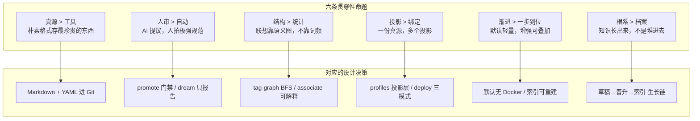

# 设计哲学与命名溯源

> 本文讲清楚 YggForge 几个核心设计决策"为什么这么选"——命名意图、文本化记忆、标签 BFS 联想图。读完你会知道这些选择不只是"能用"，而是有刻意的前瞻性与哲学取舍。
>
> 工程实现细节见 [design.md](design.md)、[memory-and-association.md](memory-and-association.md)；与竞品的对比见 [../assessments/oss-comparison.md](../assessments/oss-comparison.md)。

## 目录

- [1. 命名溯源：Yggdrasil 与 Forge](#1-命名溯源yggdrasil-与-forge)
- [2. 为什么用文本化记忆](#2-为什么用文本化记忆)
- [3. 为什么用标签 BFS 联想图](#3-为什么用标签-bfs-联想图)
- [4. 单仓库、多投影：真源不绑定工具](#4-单仓库多投影真源不绑定工具)
- [5. 制度分层 × 联想分层：两个正交维度](#5-制度分层--联想分层两个正交维度)
- [6. 晋升门禁：知识治理而非知识生成](#6-晋升门禁知识治理而非知识生成)
- [7. 与人类记忆的同构：从认知科学看 YggForge](#7-与人类记忆的同构从认知科学看-yggforge)
- [8. 贯穿性的设计哲学](#8-贯穿性的设计哲学)

---

## 1. 命名溯源：Yggdrasil 与 Forge

### Yggdrasil：连接多界的根系

`Ygg` 取自北欧神话中的 **Yggdrasil**（世界树）。

在北欧宇宙观里，Yggdrasil 是一棵巨树，它的根系穿透并连接了九个世界——神界、巨人界、冥界、人类界……都在同一棵树上。三个根分别伸向不同的泉水，命运三女神（诺伦，Norns）每天用泉水浇灌树根，维持整棵树的生机。

这个意象和 YggForge 想做的事高度同构：

| 神话里的 Yggdrasil | YggForge 里的对应 |
| --- | --- |
| 一棵树连接九个世界 | 一份真源连接多个 Agent、多个项目、多个知识层 |
| 根系穿透不同界域 | 同一套规范投影到 Cursor / Codex / OpenCode，不绑定某一个 |
| 诺伦每日浇灌泉水维持生机 | `graph build`、`promote`、`last_reviewed` 持续维护知识 |
| 树是活的，会生长、会演化 | 知识不是堆进去的，是"长"出来的（草稿 → 晋升 → 索引） |

还有一个更深的典故：Yggdrasil 这个名字本身，`Ygg` 是神王奥丁（Odin）的别名，意为"令人敬畏者"；`drasil` 意为"骏马"。所以 Yggdrasil 字面是"奥丁的坐骑"。传说奥丁曾把自己倒挂在世界树上九天九夜，以献祭的代价换取了**智慧**——卢恩文字。

这个典故不是随便选的。它点出一个被很多知识系统忽略的事实：**知识不是免费的**。你要付出成本——人审门禁、元数据维护、标签图保养——才能得到"可用的智慧"。YggForge 把这个成本显式化：晋升要门禁，条目要 id/tags/来源/置信度，不是 Agent 随便写一句就进库。

一句话：**YggForge 不是一个被动档案馆，是一棵活的、需要浇灌的、连接多界的根系。**

### Forge：从矿石到工具

`Forge` 是锻造。锻造不是"收集"，是"加工"——把矿石变成可用的工具。

锻造有完整工序，YggForge 的闭环和它一一对应：

| 锻造工序 | YggForge 对应 |
| --- | --- |
| 原材料 | `sources/inbox`、`ygg remember` 写的草稿 |
| 熔炉提炼 | `distill` / `dream` 扫描提炼 |
| 铁砧与门禁 | `promote` 审核晋升（自动推进 / 人工审核） |
| 铁匠 | 人 + AI 协作 |
| 成品工具 | `knowledge/rules|templates|lessons` 可被检索复用的条目 |

锻造出来的东西是"能用的工具"，不是"展览品"。所以 YggForge 的知识条目要能被 `ygg associate` 检索到、被 Agent 精读后直接指导工作，而不是写完就躺在文件夹里没人看。

锻造还有个特性：**可复现**。同样的原料、同样的工序，能再次产出同样的成品。这对应 YggForge 的"生成物可重建"——catalog、tag-inverted 这些索引丢了不怕，`ygg graph build` 随时重建，真源正文一直在 Git 里。

合在一起，**YggForge = 以世界树的根系连接多界，以锻造的工序把原料变成可复用的工程资产**。名字本身就是设计意图的浓缩。

---

## 2. 为什么用文本化记忆

YggForge 的知识真源是 **Markdown + YAML front matter**，纯文本，进 Git。每条正式条目有 `type`（rule/lesson/…），结构化元数据进 YAML、叙述留正文（见 `schemas/knowledge-item.schema.yaml` v2）。这个选择是有意对抗另外两条路：向量数据库（embedding + 向量检索）和专用知识图谱数据库（Neo4j 等）。

为什么坚持文本？五条理由，每条都对应一个被忽视的事实。

### 2.1 十年可读：知识的寿命应长于创造它的工具

向量库的 embedding 是某个**特定模型**在某个**特定时刻**生成的。模型 3-5 年迭代一代，维度变了、语义空间变了，旧的 embedding 就成了"不可再联想"的死数据。你今天用 SOTA 模型生成的向量，5 年后模型退役，你的知识库就降级成只读档案。

数据库格式更脆弱——版本迁移、schema 变更、引擎替换，每一步都可能损坏数据。

Markdown 是纯文本。**30 年后任何编辑器都能打开**。Git 本身就是为文本设计的——diff、blame、branch、cherry-pick 都是文本原生能力，不需要任何额外工具就能看懂"这条规范从什么时候、被谁、改了什么"。

哲学命题：**知识的寿命应该长于创造它的工具。** 你用今天最酷的模型存知识，但模型会退役；用最朴素的格式存，格式不会退役。所以最珍贵的东西，用最朴素的容器。

### 2.2 可审计：AI 可以提议，但人要拍板

YggForge 有一条硬规矩：强规范（`rules/`）必须人审，AI 不能静默改章程。

这要求知识以**人能直接读懂**的形式存在。Markdown 人能读、能挑错、能 review。向量是黑盒——你看到"相似度 0.87"，但不知道为什么 0.87，不知道这条和那条到底哪里像。

如果真源是向量，人审就无从谈起：你没法 review 一个 1536 维的浮点数组。所以"人审门禁"这个设计，**前提就是文本化**。

### 2.3 可版本化：知识是有历史的

错题本的价值在于"我上次这么干错了"。这个"上次"必须可追溯——什么时候踩的坑、什么时候立的规矩、中间改过几次。

Git diff 对文本能精确到行，能回答"这条规则上周三被谁从'建议'改成了'必须'"。向量库的 diff 是没有语义的——embedding 变了就是变了，无法 review。

知识不是瞬态的，是**有时间维度的**。文本 + Git 让这个维度天然可追溯。

### 2.4 可投影：真源不绑定消费它的工具

同一份 Markdown，Cursor 读、Codex 读、OpenCode 读、人也能读，不需要为每个 Agent 转换格式。

向量库是绑死在某个检索引擎上的——换引擎就得重新 embed。专用图数据库绑死在查询语言和存储格式上。

YggForge 的投影层（`profiles/`）只做"给工具一个它能识别的入口"，真源格式不动。**一份真源，多个投影**，这是文本化才能轻松做到的事。

### 2.5 低门槛：默认能跑 > 默认强大

不需要 Docker、不需要 GPU、不需要 embedding 服务、不需要数据库常驻。Python 3 + Git 就能跑。

这不是"做不出重型的"，是**故意把重型设为可选**。向量检索、语义相似度这些能力可以叠加上来（见 [../opt-plan/03-optimizations.md](../opt-plan/03-optimizations.md)），但不应成为使用门槛。小团队今天就能用，不需要基础设施投入。

哲学命题：**默认能跑，比默认强大更重要。** 强大但跑不起来的系统，不如朴素但人人能跑的系统。

### 最终效果

| 特性 | 文本化记忆带来的 |
| --- | --- |
| 寿命 | 知识活过工具的迭代周期 |
| 治理 | 人能审、能挑错、能回滚 |
| 历史 | 每次改动可追溯到人和时刻 |
| 兼容 | 一份真源喂多个 Agent |
| 门槛 | 零基础设施，今天就能用 |

---

## 3. 为什么用标签 BFS 联想图

YggForge 的联想靠**标签图 + BFS 扩跳**，不靠向量、不靠关键词词频。这个选择同样是有意对抗主流 RAG 方案的。六条理由。

### 3.1 模拟人类联想：激活扩散，不是关键词命中

人脑回忆一件事，不是在脑子里跑全文搜索，而是**联想**——想到"拿铁"，脑子里浮现的不是"拿铁"这个词的出现位置，而是"咖啡 → 牛奶 → 奶泡 → 卡布奇诺"这条联想链。

认知科学里这叫**激活扩散模型**（Spreading Activation，Collins & Loftus, 1975）：一个概念被激活，会沿着语义网络扩散到相邻概念，扩散强度随距离衰减。

YggForge 的 `tag-graph.yaml` 就是这张语义网络，tag↔tag 边是联想路径，BFS 扩跳就是"想到一层再想到下一层"。`ygg associate --tag coffee --hop 2` = "从 coffee 出发，联想两跳"。

这比关键词搜索更接近人类记忆的工作方式。关键词搜索是"这个词出现在哪些文档里"，联想是"想到这个，会联想到哪些"。（这个对应关系的完整论证见 [§7.1](#71-激活扩散--标签-bfs-联想)。）

### 3.2 可解释：联想路径可审计

`ygg associate` 输出每条命中都带 `via_tags` 和 `tag_hop`——你能看到"为什么命中这条"：

```text
命中: espresso-1-2-萃取基线.md
  via_tags: [coffee, espresso, grind]
  tag_hop: 0 (coffee), 1 (espresso), 2 (grind)
```

向量检索只给你"相似度 0.87"，不告诉你"因为 coffee 关联到 espresso，espresso 关联到 grind，所以命中"。

可解释意味着**可调试、可信任**。如果 Agent 说"根据联想我建议这么做"，你能看到它的联想路径，判断这条路走得对不对。这对工程知识系统尤其重要——你不会希望 Agent 拿一个黑盒相似度来决定要不要改你的代码规范。

### 3.3 人可控：拓扑自动维护，人可方便干预

联想拓扑大部分是**自动维护**的：`ygg graph build` 扫描每条条目的 front matter `tags`，自动生成 tag→条目反查表；`ygg tag --suggest` 用 PPMI 共现统计自动建议新边。你不需要手工画整张图。

但人可以**方便地干预**：在 `tag-graph.yaml` 里手动加边、调权重、删错误关联，`--apply` 确认建议边。你比 GPT 更懂你的领域该联想什么——你知道"红烧"该关联到"酱油"和"冰糖"，而不是"红色"这个词的词频邻居。

向量是模型生成的，人很难干预——你不能"手动调整"一个 embedding 的某个维度。如果模型把"红烧"和"红茶"算得很近（都带"红"），但在你的厨房里这俩根本不是一回事，你很难纠正它。

哲学命题：**联想的拓扑应该自动维护、人可方便干预，而不是由通用模型生成、人难插手。** 自动维护省去手工画图的负担，方便干预保证领域专家始终有最终发言权——两样都要，缺一不可。

### 3.4 轻量且可重建：索引是衍生物，真源是正文

`tag-graph.yaml` 是 YAML，`catalog` / `tag-inverted` 是 TSV——纯文本，Git 友好。`ygg graph build` 随时重建，索引丢了不怕。

不需要向量服务常驻，不需要 GPU 跑 embedding，不需要图数据库。联想靠的是几个文本文件 + 一段 Python。

哲学命题：**索引是衍生物，真源是正文。** 丢了索引能重建，丢了正文就真没了。所以把精力花在正文上，索引让它可重建。

### 3.5 渐进增强：先骨架，后叠加

现在是纯 tag BFS。未来可以加 `weight`（按强度排序联想）、加时间衰减（新条目优先）、加语义相似度（向量辅助）。

但这些都是**叠加**，不是**替换**——tag 图作为骨架一直在。即使将来加了向量，tag BFS 仍然是默认路径，向量只是可选增强。

哲学命题：**先保证最小可用，再渐进增强。** 不要一上来就上向量库，先把轻量的联想跑通，跑通了再按需加。

### 3.6 抗噪声：靠结构，不靠统计

关键词搜索会被高频词淹没——"git" 出现在 100 条里，没有区分度，搜出来一堆无关的。

tag 是**人提炼的语义标签**，天然降噪。BFS 扩跳按**结构**走（图边），不按**词频**走（统计）。一条命中是因为它在联想路径上，不是因为它包含某个高频词。

哲学命题：**联想靠结构，不靠统计。** 结构是人定义的语义关系，统计是机器数词频——前者更准、更可解释、更可干预。

### 3.7 为什么不用多层记忆 / 多层联想

有一种常见的设计思路：把记忆在**写入时**就分配到固定层级（比如 L0 原子事实 / L1 场景摘要 / L2 画像概览），检索时沿层级上下导航。YggForge 没有走这条路，而是用一张 tag 图。下面从多个角度说清楚为什么。

**层级是树，联想是图。** 固定层级是一棵树——每个节点只有一个父节点、一条向上路径。但知识的联想关系天然是一张图：一个概念可以同时关联多个其他概念。"猪肉"同时关联"红烧""饺子""回锅肉"，在树里它只能挂在一个下面，其余关联就被砍掉了。tag 图没有这个约束——一个 tag 可以连任意多个 tag，BFS 探索所有路径，不强迫"只能有一个父节点"。

**写入时钉死层级，是过早优化。** 多层记忆在写入时就把每条信息塞进某一层。但"该在哪一层"取决于查询，不取决于数据本身。同一条咖啡参数表，在"查所有咖啡参数"时是原子事实，在"概览咖啡制作"时是底层细节——写入时你不知道将来会怎么查，猜层级等于过早优化。YggForge 的做法是写入时只打 tags、不分层；查询时 BFS 的 hop 距离就是**动态涌现的层级**——离种子近的是"高层概览"，远的是"底层细节"，而且不同种子产生不同层级。层级是查询时长出来的，不是写入时钉死的。

**层级假设有唯一正确的分类法。** 多层设计隐含假设"知识有一个正确的层级分类法"。但知识没有唯一自然层级——它取决于任务、领域、视角。tag 图不强加层级，而是让多个层级从同一张图里涌现，取决于你从哪个种子出发。同一张图，从"野猪"出发，你可能联想到"努尔哈赤"→"满清"→"丧权辱国"，看到的是一条历史政治的层级；从"烹饪"出发，你联想到"菜谱"→"红烧"→"猪肉"→"野猪"，看到的是一条饮食的层级。同一个"野猪"在两条路径里出现，但它"在哪一层"完全取决于你从哪出发。

**写入时压缩会丢信息。** 多层记忆常在写入时就把原文压缩成上层摘要（L2 原文 → L1 概览 → L0 抽象）。但压缩丢细节，而某个查询需要的细节可能正是上次压缩丢掉的——而且写不回来了。YggForge 的渐进加载（见 [../opt-plan/03-optimizations.md](../opt-plan/03-optimizations.md) O8）在**查询时**分层（标题 → 摘要 → 按需全文），不在写入时压缩。全文一直在，只是按需加载。压缩发生在你"知道要什么"的查询时，不是你"猜可能要什么"的写入时。

**层级混淆治理与检索。** 有些多层设计用同一套层级既管"什么是强规范"又管"什么离什么近"。这把两个正交维度混在一起了（见 [§5](#5-制度分层--联想分层两个正交维度)）——改检索得动治理，调治理得动检索，耦合得动弹不得。YggForge 把制度分层（目录）和联想分层（tag 图）拆成两个正交维度，各管各的。

**层级是静态的，联想需要演化。** 固定 L0-L3 结构写进去后层级不变。但联想是会长的——你学了新东西，"coffee" 可能连到你之前没想到的概念上。在固定层级里加新关联要重新分层；在图里加一条边就行。图天然支持增量演化，层级结构抗拒变化。

**层级与人类记忆机制不符。** 人脑不是把信息塞进 L0/L1/L2/L3 层级，而是在语义网络里建立连接、让激活沿连接扩散（见 [§7.1](#71-激活扩散--标签-bfs-联想)）。固定层级在架构上就和激活扩散模型矛盾——激活扩散是图遍历，不是树遍历。如果你接受"联想是激活扩散"，那固定层级就是错误的数据结构。

一句话收束：**多层记忆在写入时猜层级、在树里砍关联、在压缩时丢细节、用一个层级同时管治理和检索——每一步都在过早地做不可逆的决策。** tag 图把所有这些决策推迟到查询时，让层级涌现、让关联完整、让全文常在、让治理与检索正交。不是图比层级"更先进"，是图**不做不该在写入时做的决定**。

### 最终效果

| 特性 | 标签 BFS 联想图带来的 |
| --- | --- |
| 检索方式 | "想到 A 联想到 B"，而非关键词堆 |
| 可解释性 | 联想路径可见、可调试 |
| 可控性 | 拓扑自动维护，人可方便干预 |
| 轻量 | 纯文本索引，零基础设施 |
| 可扩展 | 向量/语义可叠加，骨架不变 |
| 抗噪声 | 靠语义结构，不被高频词淹没 |

---

## 4. 单仓库、多投影：真源不绑定工具

这是 YggForge **最重要的设计点**（见 [design.md](design.md) §5）。仓库本身保存 canonical source，部署时再根据目标 Agent 生成它需要的投影。

### 4.1 为什么不直接复制给每个 Agent

最朴素的做法是：给每个 Agent 复制一份规范。但这会导致 N 份独立副本各自漂移——你在 Cursor 里改了一条，Codex 里还是旧的，下次同步又得手动对齐。副本越多，真相越模糊。

YggForge 的做法是**只存一份真源，投影多份入口**：

```text
yggforge-core（唯一真源）
   ├─ deploy link  → ~/.cursor/yggforge-core   （junction，零拷贝）
   ├─ deploy link  → ~/.codex/yggforge-core     （symlink，零拷贝）
   └─ deploy copy  → ~/.config/opencode/yggforge-core  （副本，需显式回导）
```

### 4.2 三种投影模式

| 模式 | 做法 | 适合 |
| --- | --- | --- |
| `link` | symlink / junction 指向仓库 | 默认；改了真源即刻生效，零拷贝 |
| `copy` | 复制文件 | 不支持链接或行为不稳定的工具 |
| `render` | 渲染出工具专用入口 | 需要工具特定格式的场景 |

### 4.3 同步语义不对称

关键洞察：**同步不是对称的**。

- `link` 模式下，Agent 对投影文件的修改天然已经落在仓库里——因为投影就是仓库本身的一个链接
- `copy` 模式下，Agent 改的是副本，需要显式导回仓库
- `render` 模式下，渲染结果是生成物，应进 `yggforge-generated/`

这意味着选 `link` 不仅能省空间，还能让"Agent 的修改"和"真源的演化"自动合一，不需要额外的回导步骤。

哲学命题：**真源不应该绑定消费它的工具。** 一份真源，多个投影——投影是衍生物，丢了能重建；真源是唯一的，丢了就没了。这和"索引是衍生物，正文是真源"是同一个道理在不同层面的体现。

### 最终效果

| 特性 | 单仓库多投影带来的 |
| --- | --- |
| 一致性 | 一份真源，不存在副本漂移 |
| 零拷贝 | link 模式下投影即链接，改了即刻生效 |
| 可回导 | link 模式下 Agent 修改自动落回仓库 |
| 不绑定 | 同一份真源喂 Cursor / Codex / OpenCode，随时换工具 |

---

## 5. 制度分层 × 联想分层：两个正交维度

这是一个容易被忽略、但很关键的设计洞察：**目录分层和标签联想是两个正交维度，不要把它们混为一谈。**

### 5.1 制度分层：是门禁，不是图论层级

`knowledge/` 下的 `rules/`、`templates/`、`lessons/`、`decisions/`、`sources/` 这套目录，是**制度分层**——它回答的是"这条东西需要多严格的审核、能当多大的规矩"：

| 目录 | 制度含义 |
| --- | --- |
| `rules/` | 强约束，必须人审，变更谨慎 |
| `templates/` | 可复用骨架，人审 |
| `lessons/` | 经验/错题，客观知识可设自动 |
| `decisions/` | 架构取舍，人工写入 |
| `sources/` | 外部来源与提炼稿 |

这是**治理门禁**，不是检索层级。一条 rule 和一条 lesson 可以聊同一件事，但它们的"规矩强度"不同。

### 5.2 联想分层：是拓扑，不是制度层级

`tag-graph.yaml` 里的 tag↔tag 边，是**联想分层**——它回答的是"想到 X 会联想到哪些"。BFS 扩跳的 hop 数就是联想的"远近"。

一条 rule 和一条 lesson 可以共享同样的 tags（比如都带"咖啡"、"冲泡"），联想时它们会一起被命中。**目录不影响联想，联想也不影响目录。**

### 5.3 为什么必须正交

很多系统把这两者混在一起——用目录结构当检索结构，或者用图层级当治理层级。结果是要么"改个规矩得动检索"，要么"调个联想得动门禁"，耦合得动弹不得。

YggForge 把它们拆成三个正交维度：

| 维度 | 回答什么 | 谁定义 | 体现 |
| --- | --- | --- | --- |
| 制度分层 | 多严的规矩、多重的审核 | 人（门禁） | 目录 `rules/templates/lessons/…` |
| 联想分层 | 想到 X 联想到哪些 | 人（领域专家） | `tag-graph.yaml` + `related` |
| 加载分层 | 查询时读多深 | 查询参数 | hop、top-N、渐进加载 |

三者独立变化：你可以不动目录只调联想图，也可以不动联想图只调门禁，还可以不动门禁只调查询深度。

哲学命题：**治理层级、联想拓扑、加载深度是三个正交维度，不要让任何一个绑架另一个。** 制度是门禁的，联想是语义的，加载是查询的——各管各的，才能各自演化。

### 最终效果

| 特性 | 正交分层带来的 |
| --- | --- |
| 解耦 | 改门禁不动联想，调联想不动门禁 |
| 灵活 | 同一条知识可属不同制度层、共享同一联想域 |
| 可演化 | 三个维度各自独立迭代，互不拖累 |

---

## 6. 晋升门禁：知识治理而非知识生成

YggForge 把"记一笔"和"立规矩"严格分开。这背后是一个根本区分：**知识治理 ≠ 知识生成。**

### 6.1 知识有生命周期，不只是有状态

很多记忆系统把"存进去"当作终点。YggForge 不这么看——一条知识有完整的生命周期：

```text
草稿（inbox）→ dream 扫描找候选 → promote 门禁 → graph build 进索引
   ↑ status: draft                    ↑ status: active    ↑ 可被 associate 命中
```

条目带 `status`（draft/active）、`last_reviewed`（上次审核时间）、`scope`（适用范围）、`source`（来源）、`confidence`（置信度）。这不是静态归档，是有生命周期的资产——会过时、需要复审、可以退役。

### 6.2 dream 只报告，promote 才动手

`ygg dream` 扫描草稿，找出重复与晋升候选——但它**只出报告，绝不自动动手**。真正把草稿变成正式条目的是 `ygg promote`，而 promote 到 `rule`（强规范）必须人审。

为什么这么设计？因为如果没有这道门，AI 会**静默改你的章程**——它在对话里"觉得"某条该成规范，就悄悄写进 rules，你下次才发现规矩变了。这在工程团队里是不可接受的：规范变更必须可审计、可追溯、可追责。

### 6.3 客观知识的自动通道

纯客观知识/信息（参数表、事实记录、手册条目）不必等重复 2-3 次，可走自动晋升：

```text
ygg promote reference --entry <draft> --auto --objective
```

脚本自动做两道检查：behavior 门禁（`promote.auto_to_reference` 默认 allow）+ 标签联想查重（无雷同才放行）。有雷同就跳过为 `duplicate_candidate`，仍需人工处理。

但 **批处理不能静默写 rules**——`promote.auto_to_rule` 默认 deny。用户**显式站立偏好**（「以后一直这样」「写成规则」或 `remember --as rule`）视为人类确认，走 `promote.auto_to_rule_on_standing`（默认 allow）。这不是 AI 自作主张，而是用户话术本身完成了拍板。

哲学命题：**AI 可以记录、整理、提议，但人决定什么成为强规范。这是知识治理，不是知识生成。** 治理关心的是"什么能当规矩、规矩怎么变"，生成关心的是"怎么把信息记下来"——前者必须有人拍板（含站立话术确认），后者可以自动化。

### 最终效果

| 特性 | 晋升门禁带来的 |
| --- | --- |
| 防静默改章程 | AI 不能偷偷把草稿变成强规范 |
| 可审计 | 每次晋升有 Git diff，可追溯人和时刻 |
| 有生命周期 | 条目会过时、可复审、可退役，不是静态归档 |
| 客观知识可提速 | 纯信息类走自动通道，不卡在人审上 |
| 强规范守底线 | 批处理不能静默写 rules；站立偏好话术才算人审确认 |

---

## 7. 与人类记忆的同构：从认知科学看 YggForge

前面几节讲的是"为什么这么选"。这一节讲一个更深的事实：**YggForge 的核心管线不是"借鉴"人脑，而是在计算层面同构于已被认知科学验证的人类记忆模型。** 这不是文学比喻，是结构对应。

### 7.1 激活扩散 → 标签 BFS 联想

1975 年，Collins 和 Loftus 在 *Psychological Review* 上发表了**激活扩散理论**（Spreading Activation）。这个模型认为：人脑的语义记忆是一张概念节点网络，节点之间由联想连接相连；当你激活一个概念（比如"鸟"），激活会**自动沿连接扩散**到相邻概念（"动物""飞""羽毛"），扩散的强度和速度取决于连接的强度，并随距离衰减。

YggForge 的 `ygg associate` 在计算层面复现了这个模型：

| 激活扩散模型 | YggForge 对应 |
| --- | --- |
| 概念节点 | tag（标签） |
| 节点间的联想连接 | `tag-graph.yaml` 里的 tag↔tag 边 |
| 连接强度 | 边的 `weight` 字段（数据模型已预留；当前 BFS 按 hop 距离排序，按 `weight` 加权扩散见 [05-weight-design.md](../opt-plan/05-weight-design.md)） |
| 激活扩散的距离衰减 | `hop` 参数（近的 hop 先命中、先排序）；`hop_decay` 衰减系数为计划增强项（见 [05-weight-design.md](../opt-plan/05-weight-design.md) §3.6） |
| 从多个概念同时扩散直到相交 | 多个 seed tags 同时 BFS，取并集 |

关键区别在于：向量检索是在高维空间里找"最近的点"（最近邻搜索），而人脑的联想是**沿连接走**（图遍历）。这是两种根本不同的计算模型。YggForge 选择后者，因为它更接近人类记忆的工作方式——"想到 A 联想到 B"本质是图上的路径，不是空间里的距离。

### 7.2 记忆系统巩固 → remember / dream / promote

认知科学里有一个被广泛验证的**系统巩固模型**（Active Systems Consolidation）：人脑的记忆不是"存进去就完了"，而是经历一个从海马体到新皮层的转移过程。

```text
白天：海马体快速编码新经验（临时存储，不筛选）
    ↓
睡眠（NREM）：海马体 sharp wave ripple 重放白天经验
    → 标记哪些值得巩固（但不直接决定，只出"候选"）
    ↓
选择性巩固：显著、重复的经验从海马体转移到新皮层
    → 成为稳定的长期记忆；其余的逐渐淡忘
```

YggForge 的沉淀管线在计算层面同构于这个过程：

| 人脑记忆巩固 | YggForge 对应 | 同构点 |
| --- | --- | --- |
| 海马体（快速编码，临时存储） | `ygg remember` → `runtime/raw` + `lessons/inbox` | 快速落草稿，不筛选 |
| 睡眠重放（标记候选，不自动巩固） | `ygg dream --scan`（只出报告，不自动 promote） | **dream 对应睡眠**——扫描找候选，但不动手 |
| 选择性巩固（显著/重复的才转移） | `ygg promote`（人审门禁 / 客观知识自动通道） | 不是所有草稿都晋升，有选择 |
| 新皮层（长期结构化存储） | `knowledge/rules\|lessons\|...` | 正式条目，带生命周期 |
| 再巩固（回忆时记忆重新不稳定） | `last_reviewed` 字段 + 复审 | 知识会过时，需要重新审核 |

**为什么 dream 只报告不自动 promote？** 因为这对应了睡眠重放的本质——睡眠重放标记候选，但不直接决定什么被巩固。大脑的巩固是**有选择性的**，受情绪显著性、重复度等调控。YggForge 用人审（和客观知识的联想查重自动通道）来扮演这个"选择性"角色。如果 dream 直接自动 promote，就等于"睡眠时把所有重放的内容都永久记住"——那不是大脑的工作方式，也会把噪声固化成规范。

### 7.3 为什么这很重要

说"同构"而不是"比喻"，是因为这不只是看起来像，而是**计算结构对应**：

- 激活扩散是图遍历，`associate` 也是图遍历——同一个计算模型
- 系统巩固是"临时存储→扫描候选→选择性转移→长期存储"，`remember→dream→promote` 也是——同一个管线结构
- 数据模型里连接强度对应 `weight` 字段（同一参数语义）；`associate` 的扩跳按**路径强度 `∏w`** 与**代价 `-ln(w)`** 加权扩散（`w<0.15` 不扩、`hop_decay` 衰减），见 `docs/opt-plan/05-weight-design.md` 与 `06-o1-o3-decision.md`

这意味着 YggForge 的设计不是凭直觉拍脑袋，而是**站在认知科学的肩膀上**：它的核心管线在计算层面同构于经过数十年实验验证的人类记忆模型。当你在 YggForge 里跑 `ygg associate --tag coffee --hop 2` 时，你做的计算，和你的大脑想到"咖啡"后联想到"浓缩""奶泡"的过程，在结构上是同一件事。

---

## 8. 贯穿性的设计哲学

前面七节讲的是具体决策。把它们抽出来，YggForge 贯穿着六条哲学命题。这些命题不是装饰，是每一个设计取舍的底层逻辑。

### 8.1 真源 > 工具

知识的寿命应该长于创造它的工具。所以用最朴素的格式（文本）存最珍贵的东西，把工具特定的东西（投影、索引）留作衍生物。

**体现：** Markdown 真源进 Git；向量/索引/渲染产物都是可重建的生成物；Agent 绑定靠投影层而非真源格式。

### 8.2 人审 > 自动

AI 可以记录、整理、提议，但强规范必须人拍板。这是"知识治理"，不是"知识生成"。

**体现：** 批处理 `promote --auto --to rule` 必须人审（`auto_to_rule` 默认 deny）；`dream` 只出报告不自动晋升。用户显式站立偏好走 `auto_to_rule_on_standing`。客观 `lessons` 可设自动，且有联想查重兜底。

### 8.3 结构 > 统计

联想靠语义结构（tag 图），不靠机器统计（词频/向量）。结构自动维护、人可方便干预、可解释、可审计。

**体现：** `graph build` 自动生成反查表；`tag --suggest` 自动建议边；`tag-graph.yaml` 人可方便修改；`associate` 输出 `via_tags` / `tag_hop`；BFS 按图边走，不按词频走。

### 8.4 投影 > 绑定

一份真源，多个投影。不绑定某一个 Agent，不绑定某一个检索引擎，不绑定某一个 shell。

**体现：** `profiles/` 做工具适配；`deploy` 有 link/copy/render 三模式；跨平台靠薄包装 + 跨平台核心。

### 8.5 渐进 > 一步到位

默认轻量能跑，增强能力可叠加。不要让基础设施成为使用门槛。

**体现：** 默认无 Docker/向量/GPU；`ygg graph build` 一行重建索引；向量/RRF/时间窗都在 opt-plan 里作为可选增强。

### 8.6 根系 > 档案

不是被动存东西，是活的、可演化、可投影的根系。知识要"长"出来，不是"堆"进去。

**体现：** 草稿 → `dream` 扫描 → `promote` 门禁 → `graph build` 进索引，是一条生长链；条目带 `last_reviewed`、`status`、`scope`，有生命周期而非静态归档。

---

### 一张图收束



这些命题互相支撑，不是孤立的：文本化（真源 > 工具）让人审成为可能（人审 > 自动）；人审要求联想可解释（结构 > 统计）；可解释的联想要轻量可重建（渐进 > 一步到位）；轻量让多 Agent 投影可行（投影 > 绑定）；投影让知识能持续生长（根系 > 档案）。

**这就是 YggForge 的设计哲学：不是堆功能，是让每一个取舍都站得住脚，且互相咬合。**

---

## 相关文档

| 主题 | 去哪 |
| --- | --- |
| 工程实现与目录结构 | [design.md](design.md) |
| 记忆与联想的机制细节 | [memory-and-association.md](memory-and-association.md) |
| 检索约定与 id 格式 | [retrieval-conventions.md](retrieval-conventions.md) |
| 第一性原理与过滤准则 | [../opt-plan/00-first-principles.md](../opt-plan/00-first-principles.md) |
| 与竞品的对比 | [../assessments/oss-comparison.md](../assessments/oss-comparison.md) |
| 仓库根叙事 | [../../README.md](../../README.md) |
