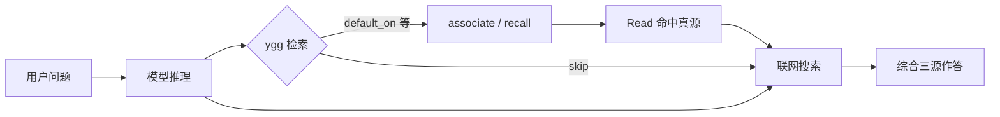

# 检索约定

## 目录

- [1. 目标](#1-目标)
- [2. 推荐 metadata 字段](#2-推荐-metadata-字段)
- [3. 推荐文档结构](#3-推荐文档结构)
- [4. 目录分层约定](#4-目录分层约定)
- [5. 知识图与联想检索](#5-知识图与联想检索)
- [6. file backend 下的文本 recall](#6-file-backend-下的文本-recall)
- [7. 显式过滤](#7-显式过滤)
- [8. 自动索引](#8-自动索引)
- [9. Agent 如何综合回答（三源）](#9-agent-如何综合回答三源)

---

## 1. 目标

`YggForge` 当前不依赖复杂 RAG。

检索质量主要依靠：

- 目录大类分层（深度有限）
- front matter（必填含 `type`；另有 `tags` / `related` / …）
- **独立的 tag 邻接图**（人脑式联想）
- 有序分片的 id/path 与 tag/ids 登记表
- 文本 `recall` 的 metadata-first 打分

## 2. 推荐 metadata 字段

正式条目索引必填（schema v2）：

- `id`
- `title`
- `status`
- `type`（`rule` / `lesson` / `decision` / `template` / `source` / `distilled-source`）

另建议补齐：

- `title_refined`（可选：优化版标题，由 LLM 提炼；**不覆盖**原始 `title`）
- `tags`
- `keywords`
- `priority`
- `scope`
- `agent_targets`
- `related`
- `when_to_read`（何时加载；勿再写正文 `## When To Read`）

说明：

- `id` 由算法生成，格式见下文「条目 id 约定」；`related` 写条目 `id`，联想查询默认只扩 **1 跳**
- front matter 用字段名 **`type`**，不要写 `kind`（catalog / CLI / JSON 里出现的 `kind` 只是展示或过滤名，值等于 `type`）
- `title` 保留原文/原始命名意图；需要简短展示或更好文件名时可另写 `title_refined`
- `tags` 可多值；tag↔tag 关系**不**写在正文里，而写在 `graph/tag-graph.yaml`
- 同义词归并见 `yggforge-core/graph/tag-synonyms.yaml`（`ygg remember --tags` / `ygg tag` 写入侧读取；`associate` 查询侧也读取，把中文 seed tag 归并到 canonical 英文 tag）
- `scope` 用短文本，便于 `--scope` 子串过滤
- `agent_targets` 缺失时，`--agent` 过滤不会命中该条目

### 条目 id 约定

正式知识条目的 `id`：

```text
{yyyymmddhhmmss}-{目录首字母定长6}-{标题词首定长8}-{4位随机}
```

- **创建时间**：`yyyymmddhhmmss`；新建取当前时间，已有文件优先用 git 首次加入时间。放在最前，便于 catalog 按时间字典序与前缀分片。
- **目录首字母（定长 6）**：相对 `yggforge-core` 路径中，各层目录名首字符（不含文件名）；仅 ASCII 字母（小写）/数字；中文等跳过；超长截断，不足右侧补 `$`
  - 例：`knowledge/rules/mycapital/foo.md` → `krm$$$`
- **标题词首（定长 8）**：英文/数字词取首字符小写；连续中文段跳过；超长截断，不足补 `$`
  - 例：`C++ Style Baseline` → `csb$$$$$`
- **4 位随机**：`[a-z0-9]{4}`，避免同秒冲突

示例：`20260714153022-krm$$$-sqr$$$$$-a3f9`

生成：`scripts/knowledge/knowledge_id.py`。

## 3. 推荐文档结构

结构化元数据进 YAML front matter（见 `knowledge-item.schema.yaml` v2），不要再用正文标题重复：

- `type`（必填）：`rule` / `lesson` / `decision` / `template` / `source` / `distilled-source`
- `when_to_read` / `applies_to` / `does_not_apply_to` / `related` / `tags`
- distilled：`facts` / `inferences` / `practices` / `risks`

正文只保留叙述块，例如：

- rule：`## Rule`（及语言标准等）
- lesson：`## Observation`、`## Principle`
- decision：`## Context`、`## Decision`
- template：`## Use Case`、`## Implementation Pattern`

## 4. 目录分层约定

- 真源放在 `knowledge/{rules,templates,lessons,decisions,sources}/`
- 按**大类 + 少量主题域**组织（如 `rules/mycapital/`）
- 相对 `knowledge/` 的路径深度 **不超过 5**（含文件名）
- 路径在索引中存相对仓库根的 posix 路径，不写机器绝对路径

## 5. 知识图与联想检索

权威与生成文件见 [../yggforge-core/graph/README.md](../../yggforge-core/graph/README.md)。

管线：

1. 给定 seed tags + hop（默认 2）
2. 在 `tag-graph.yaml` 上 BFS 得到多级相关 tag
3. 用 `tag-inverted` 并集得到条目 id
4. 再并上这些条目的 `related`（默认 1 跳）
5. 用 `catalog` 解析为可阅读路径

> seed tags 会先经 `tag-synonyms.yaml` 归并到 canonical tag（如 `拿铁` → `latte`），保证中英文都能命中已有索引；seed tag 提炼策略见 `knowledge/rules/seed-tag-language.md`。

命令：

```text
ygg graph build
ygg associate --tag simu --hop 2
ygg associate --tag git --tag workflow --json
```

边权重 `weight ∈ [0,1]` 已启用：`expand` 按路径强度 `∏w` 与代价 `-ln(w)` 排序，`w<0.15` 不扩、`hop_decay` 衰减；分档与维护见 `docs/opt-plan/05-weight-design.md` 与 `06-o1-o3-decision.md`。

## 6. file backend 下的文本 recall

当前 `recall` 的推荐思路是：

1. 先按显式过滤收窄
   - `--type`
   - `--tag`
   - `--scope`
   - `--agent`
2. 再按条目 type 优先级排序
   - rule > template > decision > lesson > source > distilled-source
3. 再按 metadata 匹配
4. 最后才按正文补充匹配

`associate` 与 `recall` 互补：前者偏结构联想，后者偏关键词打分。

## 7. 显式过滤

```text
ygg recall <query> [--type K] [--tag T] [--scope S] [--agent A] [--limit N]
```

语义：

- `--type`
  - 精确匹配条目 `type`（及目录推断）；可重复或逗号分隔
- `--tag`
  - 精确匹配（小写规范化）；多个 tag 为 AND
- `--scope`
  - 对 `scope` 做大小写不敏感子串匹配
- `--agent`
  - 精确匹配 `agent_targets`；无该字段的条目不命中

若提供了任一过滤器，`--query` 可省略；此时按条目 type 优先级与 `priority` 排序列出。

## 8. 自动索引

机器索引：

```text
ygg graph build
ygg graph check
```

人类可读 tag 页（`indexes/by-tag/*`）：

```text
ygg index
ygg index --check
```

`ygg graph build` 默认**不**导出 by-tag；人类导览请用 `ygg index` 或 `ygg graph build --with-by-tag`。

## 9. Agent 如何综合回答（三源）

当处理用户对话 / 问题 / 任务时，须综合三源（真源 `knowledge/rules/standing-preference.md`；Cursor 薄投影 `profiles/cursor/rules/ygg-answer-synthesis.mdc`）：

1. **模型自身推理** — 先形成初步理解；
2. **ygg 联想检索** — 先 `ygg tag --language` 确认 tag 规范语言（默认 `en`），再提炼 2～8 个该语言的 seed tags，**优先对齐已有 tag 体系**（复用命中条目 `tags` 字段或 `ygg tag --list`；无对应英文 tag 的中文概念中英双发），调用 `ygg associate --tag ...`（可用 `--hop`，查询侧自动经 `tag-synonyms.yaml` 归并），必要时 `recall`；阅读返回路径的真源条目；详见 `knowledge/rules/seed-tag-language.md`；
3. **联网搜索** — WebSearch / WebFetch；事实类、时效敏感、外部标准类问题必须搜索。

把三源结果一并纳入回答，标注来源与置信度；**不得仅凭 ygg 命中条目作答**。权重：时效/事实 → 联网↑；仓库规范/记忆 → ygg↑；推理/方案 → 模型↑。



这是「模型联想 + 可审计知识图联想 + 联网验证」的组合，而不是互相替代。
