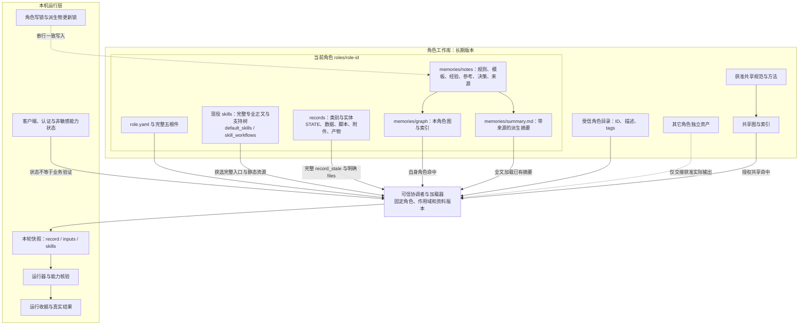
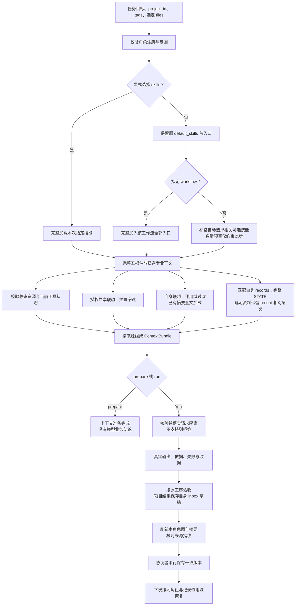

---
tags:
  - roles
  - architecture
  - memory
---
# 伙伴角色、原生记录与双路联想

更新日期：20261121。角色长期资产与本次获准执行快照分层保存，完整专业方法和真实业务资料各自归位。

## 目录

- [角色与知识空间](#角色与知识空间)
- [存储架构图](#存储架构图)
- [工作流程图](#工作流程图)
- [完整专业方法与调度](#完整专业方法与调度)
- [records与任务字段](#records与任务字段)
- [检索与记忆](#检索与记忆)
- [执行与验证边界](#执行与验证边界)
- [维护与发布](#维护与发布)

## 角色与知识空间

每个角色有受信 role_id，每次执行有独立 run_id。role.yaml 绑定完整五根件、现役 skills、默认首入口、工作流、records、共享选择和检索预算。目录 tags 用于选角色，任务 tags 用于本轮技能与知识联想。

共享空间与角色空间复用图引擎，但具有独立 catalog、标签关系、同义词、索引与边界。共享空间只扫描获准 knowledge/plugins，角色空间只扫描自己的 memories/notes。相同标签和 related 不会把另一角色的私有条目并为一个来源，也不扩展文件权限。

## 存储架构图



长期五根件、现役技能、真实 records、notes、图与摘要随角色保存。客户端、凭据、缓存、锁、临时会话、执行快照和收据留本机运行层。来源可追溯性由逐项审计承担，业务目录直接按类别与实体组织，整包来源不继续充当业务项目。

## 工作流程图



prepare 本身不执行模型，也不写虚构结论。联合任务的 dependencies 在角色级按前序真实输出交接；失败保持失败。正文和检索资料的来源与作用域不会在组包时合并掉。

## 完整专业方法与调度

角色的专业内容是完整方法、默认路由、格式和门禁的组合。它可以包含仓库勘察与调试、内容研读与样片确认、情报清洗与实体关联、统计与行情工序、音乐工厂流程，或命理的综合盘核心及四体系子流程。

默认入口负责原角色的判定与分诊；skill_workflows 明确承接需要联合加载的完整技能组。源方法中的具体步骤、参数定义、产物顺序和质量检查保留在正文及必要 reference 树中。平台工具未接通时单独记录能力状态，不能借此删除接口契约或把专业内容摘要为短包装。

显式单技能选择优先；未显式选择时加载默认入口，再按 --workflow 完整加入工作流。仅可选的自动匹配受技能数量预算限制，原默认综合流程不受这个预算截短。

## records与任务字段

```text
yggforge-core/roles/role-id/
  role.yaml
  AGENTS.md / IDENTITY.md / SOUL.md / USER.md / TOOLS.md
  skills/skill-id/SKILL.md
  skills/skill-id/{references,scripts,assets,许可}
  records/类别/实体/STATE.md
  records/类别/实体/{实际数据,脚本,附件,源稿,产物}
  memories/notes/{rules,templates,lessons/inbox,reference,decisions,sources}/
  memories/graph/
  memories/summary.md
yggforge-runtime/                 本机配置、锁、缓存、会话、收据
yggforge-generated/               可再生成的本机派生物
```

业务目录采用 records，角色配置 records 每项只有 path、state。task.project_id 与 project_root 保留原接口含义：前者是知识作用域，也可匹配自身注册记录；后者是显式外部项目根或解析到的自身记录根。未匹配的作用域不自动生成 records，也不能访问其它角色树。

record_state 提供完整 STATE 和文件清单；files 再明确授权本轮实际资料。快照内部的 record 名称是本轮执行视图，不能当成重新建立长期来源包装。静态技能资源和动态客户、学情、用户档案、业务数据分别声明与选择。

## 检索与记忆

shared_hits、role_hits 和 role_summary 保持独立。命中按标签、同义词与关联展开，正文受窄读预算限制并明确标注截断；读取相关全文依照真实路径与准入。来源、状态、时效、project_id、指纹和置信度一起保留。

五根件、获选 SKILL、STATE、角色描述和已生成 summary 在加载层全文承接。summary 的蒸馏和有限摘要条目选择是派生过程，不能误称全部 notes 全量注入；完整原笔记仍在自身 notes。

具体记录的事实保留项目作用域；未绑定个案的通用方法可进入跨项目摘要。旧 USER 原文保留来源与时效，并与新任务主体分开，旧人物、客户、成绩、持仓和权限不自动沿用。新模型结果先作 agent 来源草稿，规则晋升按门禁执行。

## 执行与验证边界

原生 subagent 与 prepare 提供逻辑上下文分离。强制文件范围需要独立运行器及真实 enforced 收据；Linux 使用 Landlock，Windows 经 WSL 执行获准快照，不直接开放整棵角色资产。

资源声明的越界、链接、凭据、生成缓存与依赖目录会拒绝投影；资源存在和 metadata.availability 不证明服务已接通。安装、认证、查询及业务验收分别留证；自动 Mock 降级仅以显式模拟模式持续标识，不充当真实行情、财务或实验数据。

运行失败、保存成功而派生刷新失败、超时和授权缺口分别报告。跨平台回归、全文件覆盖及关键业务行为以当期协调者收据为准，数量清点不能替代实际执行。

## 维护与发布

按源来源与退役标记处置废版本。用户授权清退已退役的包装时，移除其额外恢复副本及悬空路由；仍在现役被声明使用的方法、模板和许可保持完整，不能只凭文件名含 archive、history 或 cache 就误删。

图、摘要和角色版本由协调者串行维护，多个角色不同时操作 Git index。实际角色树、records、记忆与附件属于私有数据；通用框架及 [导入说明](../guide/role-import.md)、[资源说明](../guide/role-resources.md) 可按发布准入单独同步。

命令与排障见 [使用指南](../guide/roles.md)。
