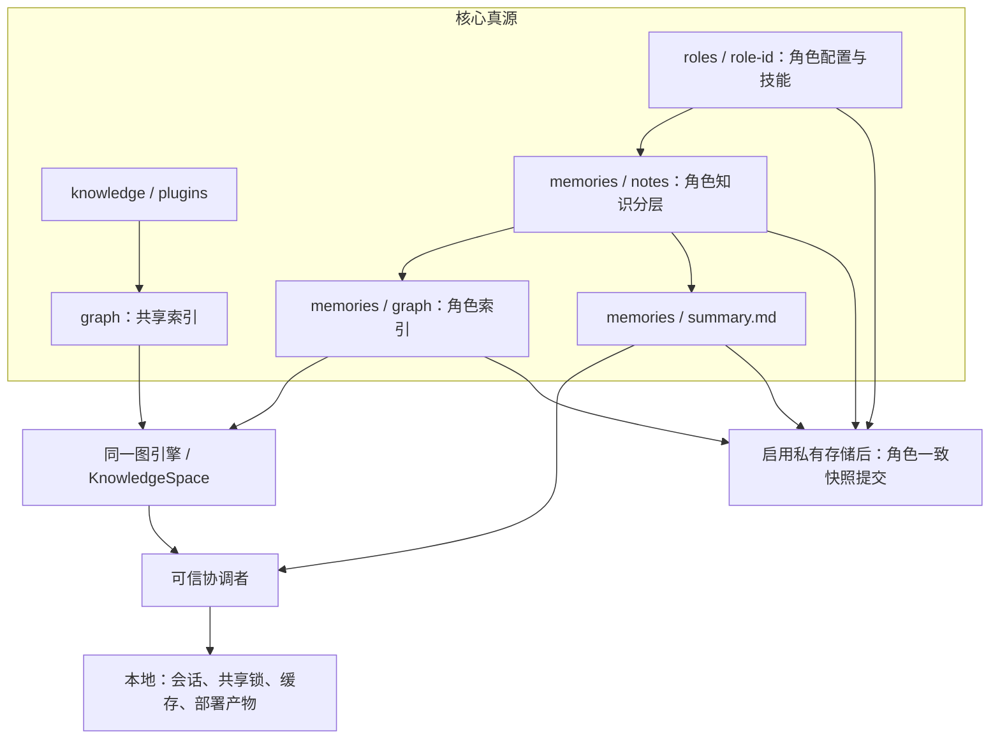
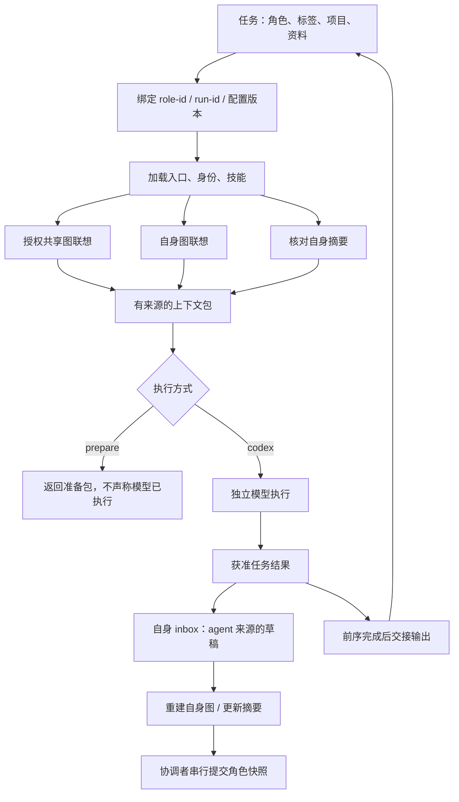

# 角色知识空间与执行流程

日期：20261120。本文描述通用实现接口，不包含实际角色记忆或用户数据。

## 目录

- [存储架构图](#存储架构图)
- [流程图](#流程图)
- [接口与边界](#接口与边界)

## 存储架构图

## 流程图

## 接口与边界

共享空间与角色空间分别携带 space_id。查询、保存、晋升和摘要使用同一空间身份，不能靠目录参数扩大范围。索引构建与记忆保存共享锁，异常保留原始记录并报告待刷新。

prepare 只准备上下文。enforced 文件模式在 Linux／WSL 用 Landlock 限定进程文件访问，模型使用原生临时工作区的获准快照；结果回收不跟随链接。普通模型服务网络连接并不因此成为网络隔离。

角色长期记忆固定排除公共框架发布。公共分发不附带实际 roles 数据，私有 Git 保存由管理者显式启用；用户可依据运行收据区分准备、完成与失败。
