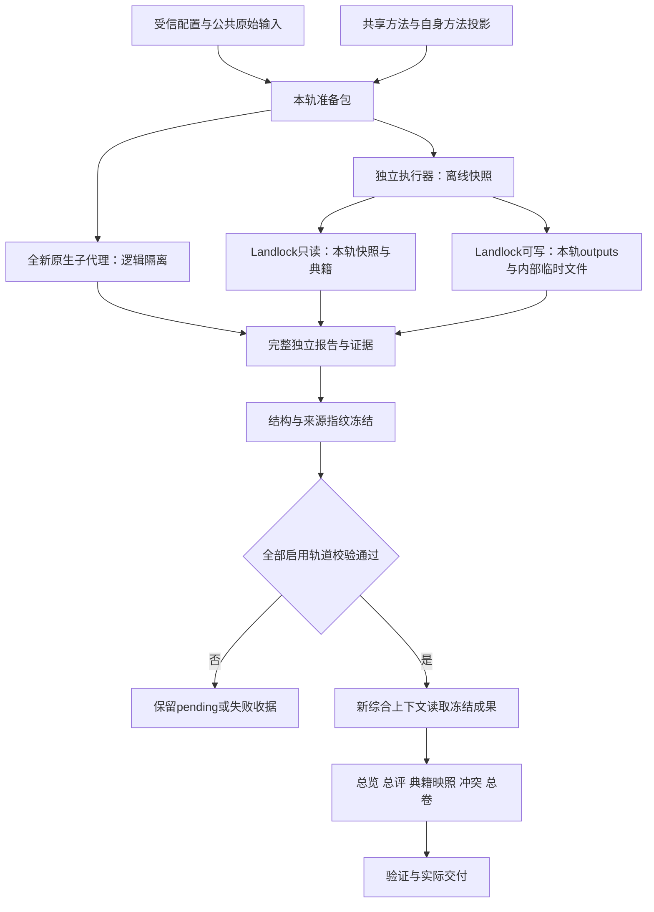

---
tags:
  - roles
  - cases
  - workflow
---
# 分轨命例与独立分析

本指南说明可复用的案件工序：公共输入、每轨独立计算与完整报告、冻结后综合。角色的原专业流程、默认入口、工作流深度和质量关卡继续适用；具体技法与人物资料由使用者自己的角色模板和 records 提供。

## 目录

- [模板与目录](#模板与目录)
- [初始化与补充专项](#初始化与补充专项)
- [分轨准备与方法投影](#分轨准备与方法投影)
- [逻辑隔离与文件隔离](#逻辑隔离与文件隔离)
- [明确非盲的回访](#明确非盲的回访)
- [冻结综合与修订](#冻结综合与修订)
- [验证与交付](#验证与交付)

## 模板与目录

`role.yaml.case_template` 指向本角色 `templates/` 下的 JSON 工序模板。模板只配置方法与资料清单，真实事实和报告存入 records。以下是需替换为实际已注册技能的结构示例：

```json
{
  "schema_version": 1,
  "input_files": ["input/facts.json", "input/questions.md"],
  "tracks": {
    "track-a": {
      "skills": ["skills/track-a/SKILL.md"],
      "required_inputs": ["input/facts.json", "input/questions.md"],
      "required_calculations": ["calculations/track-a/result.json"],
      "reference_files": []
    }
  },
  "optional_tracks": {},
  "synthesis_skills": ["skills/synthesis/SKILL.md"],
  "review_files": [],
  "review_skills": ["skills/review/SKILL.md"],
  "blind_context_files": ["SOUL.md", "templates/blind-tools.md"],
  "method_memory": [],
  "reference_roots": []
}
```

必选 `tracks` 默认全部启用；`optional_tracks` 登记可按任务额外启用的完整独立专项。`required_inputs` 只可来自公共 `input_files`，`required_calculations` 只可位于该轨 calculations。纯典籍可声明 `reference_roots`，限定在本角色 `records/library/` 或 `references/`，再用本轨 `reference_files` 或任务 `references` 明确选读，复制为离线快照；不得授予整个角色根或 records 父目录。

新案默认位于 `records/clients/<english-id>/`：

```text
CASE.json / STATE.md
input/                       获准公共原始输入、问题、来源
calculations/<track>/        本轨计算、图表、中间量与版本
analyses/<track>/            report.md、evidence.json 与独立正文
validation/<track>/          计算核验、预注册与后续反馈
provenance/                  每轨冻结收据
synthesis/                  overview.md、assessment.md、classical-reflections.md、conflicts.md、report.md
deliverables/                通过验证的最终交付
```

## 初始化与补充专项

```text
ygg role case-init <role-id> <english-id>
ygg role case-init <role-id> <english-id> --track <optional-track>
ygg role case-add-track <role-id> <english-id> --track <optional-track>
ygg role case-check <role-id> <english-id>
```

初始化创建 pending 目录、空事实和空证据，不生成虚构输入、盘面、命中或既有交付；图片等二进制须填入真实原件。重复初始化和重复专项启用会拒绝覆盖。角色配置由协调者串行更新；`case_id/record_id` 绑定正式记录，`project_id` 继续表示知识作用域。

case/record 稳定 ID 允许小写 ASCII 字母、数字、连字符和下划线，保留既有 English 代号；路径、点、驱动名和 Windows 保留设备名会被拒绝。角色和 track ID 继续使用原严格契约。已登记 record 键优先；旧案 `CASE.case_id` 可作为唯一别名解析，prepare 会归一到真实登记键，不能从目录名猜主体。`case_id` 与登记 `record_id` 可以不同，来源与作用域分别保留。

## 分轨准备与方法投影

```json
{
  "task_id": "example-independent-a",
  "prompt": "按本轨完整方法独立计算、核证并保存报告与证据",
  "record_id": "example-case",
  "project_id": "example-scope",
  "stage": "blind",
  "track": "track-a",
  "tags": ["research", "review"]
}
```

```text
ygg role prepare <role-id> --task-file <task.json>
```

准备包只含本轨获准 input、自身 calculations、完整获选技能和安全方法设定，不载整案 STATE、其他轨结果、任意依赖或客户业务摘要。AGENTS 与 IDENTITY 保持完整；SOUL 和审计后的 `templates/*.md` 方法投影由 `blind_context_files` 明确选入，原 USER/TOOLS 不进入该包。`role.metadata` 的目录、默认技能和补充设定清单同样收窄，不以元数据泄露未准入文件名。

共享联想和自身联想分别保留来源。自身命中只准入无 project/case/client/record 作用域的 `rule/template/decision`，排除客户、命例和预测标签；`method_memory` 可进一步收窄到明确审计的 `memories/` 相对 notes 文件，空列表表示不准入任何自身记忆。方法摘要从合格命中派生，并标注 `blind-method-only`；不读取原业务 summary，也不删除它。

每轨只能写 `case_policy.output_path`，按 `artifact_contract` 保存本轨 report/evidence、calculations 和 validation。回收前检查原始资料指纹，准备后输入变化时拒绝写回旧上下文成果；未知路径、链接和跨轨输出在写入前拒绝。标准案件的独立结果保存于 records，不由调度器额外写成业务记忆。

## 逻辑隔离与文件隔离

原生子代理须使用 `fork_turns=none`，只接本轨准备包；顺序分批也需要每轨新上下文。CWD、worktree、提示词和聊天子代理属于逻辑隔离，无法单独证明操作系统文件权限已受限。

```text
ygg role run <role-id> --task-file <task.json> --backend codex --isolation enforced
```

`enforced` 用受支持 Linux Landlock；Windows 经 WSL 在原生临时目录运行。源资料先复制为本轨离线快照，再只读授权该快照；写权限仅给本轨 `outputs/<track>/`、执行器临时目录和最终输出文件。子进程继承文件边界。认证与配置快照由执行器管理，不能进入报告回收。网络能力与文件隔离分别说明。



不支持、超时或执行失败时保留失败收据，不能自动降为 logical 后称 enforced 成功。只有实际 `enforced-filesystem` 收据支持文件隔离成功表述；准备包和路径探测分别记录其范围。

本机 WSL 发行版与解释器参数由运行时 `config/roles.local.json.executor.wsl_distro/wsl_python_argv` 配置，不写入角色资料或通用模板。命令参数为列表，直接传递，不拼成 shell 文本。

## 明确非盲的回访

已登记标准 CASE 的历史案件，可以以 `stage: review`、省略 track 回访。这个阶段明确非盲，不要求历史资料伪造新冻结收据；按完整 `review_skills` 先读取本案批准资料、复用既定原判，再核验新增事实与实际反馈。

资料范围仅为本案已存在的公共 input 和 manifest 显式 `review_files`。任务 `files` 可从此白名单进一步选择；不自动加载整案历史、合盘、STATE、原工具业务记录或客户摘要。另案及联合资料须独立记录和授权。blind 阶段仍完全拒绝 review/historical 文件，synthesis 仍要求所有已启用独立轨冻结。

回访成果另存 `validation/case/reviews/<run_id>/`，至少保留本轮 report.md；回收前同样检查准备时的输入指纹。新轮不得覆盖冻结报告或既有回访记录，也不能把回访结果称为新的独立盲判。

## 冻结综合与修订

独立 `evidence.json` 最少含 `schema_version: 1`、`track`、`status: completed`、真实 `source_status`、非空 `claims`。每条判词有 `id`、`text`、非空 `basis`；本地 input/calculation 引用必须实际存在并纳入冻结，不能引用其他轨报告、综合正文或业务笔记。支持的来源性质为 `unverified`、`verified-calculation`、`traditional-interpretation`，均不自动表示现实或科学验证。

```text
ygg role case-freeze <role-id> <english-id> --track <track>
ygg role case-check <role-id> <english-id> --require-frozen
```

冻结收据覆盖该轨工序、所用公共输入、全部本轨 calculations 与 analyses。缺项、占位或无据判词会阻断；冻结后文件增加、删除、修改或工序变化会使检查失败。冻结收据不能原地覆盖。validation 可保留后续现实反馈，但反馈不倒改首判。

只有所有已启用轨道通过冻结检查后，才能使用 `stage: synthesis`、省略 track 创建新综合上下文。它只加载获准输入和冻结报告、计算、证据及收据；成果为固定五项 synthesis 正文。后启用独立专项保留旧轨冻结结果，新综合等待该专项也冻结。

输入纠错或新证据需要修订时，建立新稳定 ID 的 revision record，例如同级 `example-case-r2`，重新准备和分析，保留原 record 的 CASE、计算、首判和冻结收据。在新案 provenance 记录父案 ID、修订原因及影响范围。需要嵌套 runs 物理目录时，由协调者按现有 records 注册契约设置独立记录，不能把新输入或报告覆盖旧冻结版本。

## 验证与交付

`case-check` 校验标准目录、各轨必需正文与冻结结构；`--require-frozen` 另外阻断未冻结轨道。专业关卡、计算正确性、原文引证、统计口径、版式与视觉验证由角色原流程完成。哈希一致、引擎一致和典籍出处准确分别记录，不能互相替代。

最终文件存入 deliverables；本地生成、视觉检查与实际发送分别记状态。STATE 只写真实已完成层，只有实际交付收据才可称已交付。相关代码回归见 `tests/test_role_case_blind_workflow.py`，覆盖跨轨资料泄漏、方法投影、未冻结综合、不可覆盖、旧输入拒绝回收和 Linux 子进程文件拒绝。
