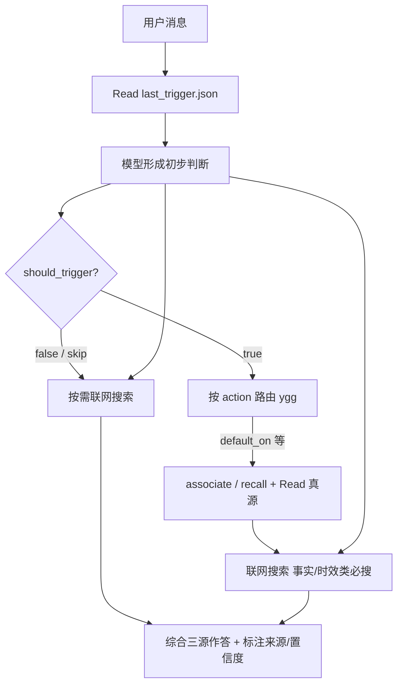

# YggForge 触发词

## 目录

- [1. 设计目标](#1-设计目标)
- [2. 总入口](#2-总入口)
- [3. 显式动作触发](#3-显式动作触发)
  - [`ygg status`](#ygg-status)
  - [`ygg deploy`](#ygg-deploy)
  - [`ygg import`](#ygg-import)
  - [`ygg sync`](#ygg-sync)
  - [`ygg push`](#ygg-push)
  - [`ygg ingest`](#ygg-ingest)
  - [`ygg distill`](#ygg-distill)
  - [`ygg remember`](#ygg-remember)
  - [`ygg tag`](#ygg-tag)
  - [`ygg promote`](#ygg-promote)
  - [`ygg index`](#ygg-index)
  - [`ygg recall`](#ygg-recall)
  - [`ygg dream`](#ygg-dream)
  - [`ygg graph`](#ygg-graph)
  - [`ygg project`](#ygg-project)
  - [`ygg associate`](#ygg-associate)
  - [`ygg behavior`](#ygg-behavior)
  - [`ygg doctor`](#ygg-doctor)
- [4. `ygg + 自然语言` 的解释规则](#4-ygg-自然语言-的解释规则)
- [5. 推荐心智模型](#5-推荐心智模型)

---

## 1. 设计目标

`YggForge` 的功能触发分为两层：

- 显式动作触发
  - 例如 `ygg status`
  - 例如 `ygg ingest`
- 通用入口触发
  - 例如 `ygg 把这篇文章收进知识库`
  - 例如 `ygg 把这个经验升级成规则`

设计原则：

- 尽量少记命令
- 同时保留稳定、低歧义的快捷入口
- 不要求用户记住内部脚本名或目录结构
- 允许 Agent 根据自然语言判断应调用哪类 YggForge 功能

## 2. 总入口

最上层入口就是：

- `ygg`

当用户只写：

- `ygg ...`

后面跟的是自然语言描述时，Agent 应先判断用户意图属于哪一类：

- 部署
- 导入
- 状态检查
- 多机 git 同步
- 来源归档
- 来源提炼
- 经验记录
- 规则晋升
- 索引更新

然后再路由到对应功能。

## 3. 显式动作触发

以下是第一版推荐动作词。

### `ygg status`

用途：

- 查询部署状态
- 查询某个 target 是否已经 link / copy / render
- 查询最近一次部署模式

### `ygg deploy`

用途：

- 把 YggForge 内容部署到某个 Agent

### `ygg import`

用途：

- 在 `copy` 或 `render` 模式下，把目标侧改动导回仓库

### `ygg sync`

用途：

- 多机 git 更新
- 默认理解为 `update`

### `ygg push`

用途：

- 多机场景下先更新再 push

### `ygg ingest`

用途：

- 把链接、文件、原始材料收进来源区

### `ygg distill`

用途：

- 从原始来源生成提炼结果

当前已具备第一版自动化能力，可从 `inbox` 条目生成 `distilled` 草稿。

### `ygg remember`

用途：

- 记录错题、经验、长期记忆
- 支持 `--tags`（LLM 供 tag，脚本按 `yggforge-core/graph/tag-synonyms.yaml` 归并）
- 支持 `--title-refined`（优化版标题，不覆盖原始 `--title` / 推导 title）
- 支持 `--as rule` / `--standing`：站立偏好写入 inbox 后自动晋升 `rules/`（`promote.auto_to_rule_on_standing` 默认 allow）；正文命中「以后一直这样」等句式亦自动识别
- 支持 `--json`

### `ygg tag`

用途：

- `--list`：列出 tag-graph 标签
- `--add T1 T2`：添加标签节点
- `--relate A B`：建立双向关联
- `--propagate T`：输出传播审查报告（**不自动改文件**）
- `--language`：查询 tag 规范语言（`en`/`zh`，配置见 `graph/tag-synonyms.yaml`，缺省 `en`）；生成 seed tags 或新增 tag 前先调用

### `ygg promote`

用途：

- 把经验或来源结论晋升到 rule / lesson / reference / template / decision（`ygg promote --to decision`）
- `--auto --to reference --objective`：客观知识自动晋升（`promote.auto_to_reference` 默认 allow），脚本自动跑标签联想查重防雷同
- `--auto --to rule --standing`：用户显式站立偏好自动晋升（`promote.auto_to_rule_on_standing` 默认 allow）；无 `--standing` 的批处理仍需人审（`auto_to_rule` 默认 deny）

### `ygg index`

用途：

- 根据正式知识条目的 front matter `tags` 更新索引
- 可选导出 `indexes/by-tag/`（含导出时间与 commit）
- 可用 `--check` 校验是否与磁盘一致
- 可用 `--dry-run` 只预览将写入的文件

### `ygg recall`

用途：

- 按查询词与 `--type`（条目 type）/`--tag`/`--scope`/`--agent` 过滤检索知识与运行时记忆
- 偏 metadata / 正文打分，与 `associate` 互补

### `ygg dream`

用途：

- 扫描运行时记忆，找重复候选与待晋升候选

### `ygg graph`

用途：

- `ygg graph build`：重建 `yggforge-core/graph/catalog` 与 `tag-inverted` 有序分片（随核心包部署；默认不导出 by-tag）
- `ygg graph check`：校验缺 id/`type`、死 related、路径过深、front matter schema v2 等警告

### `ygg project`

用途：

- `ygg project mdc`：按 `always_apply: true` 将 `knowledge/rules/*.md` 投影为 `profiles/cursor/rules/*.mdc`
- `ygg project mdc --check`：只检查 manual 目标是否存在、sync 目标是否需更新
- 真源后缀保持 `.md`；薄投影带 `alwaysApply: true`

### `ygg associate`

用途：

- 从 seed tags 出发做多跳 tag 联想，再收集条目与 related，输出可阅读路径
- 约定见 [retrieval-conventions.md](../concepts/retrieval-conventions.md)

### `ygg behavior`

用途：

- 查看当前生效的行为策略（记忆/晋升/dream/core_write/特性开关）
- 配置见 [behavior-config.md](behavior-config.md)

### `ygg doctor`

用途：

- 一站式健康检查：Python / git / 布局 / 配置 / catalog / MDC 投影 / 重复 id / hooks / trigger
- 输出红/黄/绿；非零退出码表示有 P0 问题
- 新用户部署后建议先跑 `ygg doctor` 确认环境就绪

## 4. `ygg + 自然语言` 的解释规则

当用户写：

- `ygg` + 一段自然语言

Agent 应优先做以下判断：

1. 这是在描述“来源进入知识库”吗？
   - 若是，优先映射到 `ingest`
2. 这是在描述“提炼已有来源”吗？
   - 若是，优先映射到 `distill`
3. 这是在描述“把经验写下来”吗？
   - 若是，优先映射到 `remember`
4. 这是在描述“升级为规则/模板/lesson”吗？
   - 若是，优先映射到 `promote`
5. 这是在描述“部署/导入/状态”吗？
   - 若是，优先映射到 `deploy / import / status`
6. 这是在描述“多机同步 git”吗？
   - 若是，优先映射到 `sync / push`
7. 这是在描述“回忆 / 搜索记忆”吗？
   - 若是，优先映射到 `recall`
8. 这是在描述“建图 / 重建知识索引”吗？
   - 若是，优先映射到 `graph build`
9. 这是在描述“按 tag 联想检索”吗？
   - 若是，优先映射到 `associate`
10. 这是在描述“管理标签 / 标签传播审查”吗？
   - 若是，优先映射到 `tag`

如果一句话同时命中多个动作，应优先按“更具体的动作”理解。

例如：

- `ygg 把这篇文章收进知识库并提炼`
  - 先 `ingest`
  - 再 `distill`
- `ygg 把这个经验写进错题本并升级成规则`
  - 先 `remember`
  - 再 `promote`

## 5. 推荐心智模型

用户可以这样理解：

- 想明确指定动作时，用 `ygg <动作>`
- 不确定动作名时，用 `ygg <自然语言>`
- Agent 负责把这句意图映射到 `YggForge` 的具体功能

## 6. 默认触发模式（default_trigger_on_chat）

上面第 4 节的「`ygg + 自然语言`」要求消息以 `ygg` 开头才路由。本特性**部署默认开启**：不写 `ygg` 前缀，每条对话也默认先过 `trigger_detector.py` 判断是否走 ygg 检索；若想回到只在显式 `ygg ...` 时触发，本机 local 覆盖为 `false`。

### 开关

配置项：`behavior` 的 `features.default_trigger_on_chat`（见 [behavior-config.md](behavior-config.md)）。

| 值 | 行为 |
| --- | --- |
| `true`（部署默认） | 除命中否定模式外，每条用户消息都先过 `trigger_detector.py` 判断 |
| `false`（本机 local 覆盖） | 仅显式 `ygg ...` 或命中高/中置信度模式时触发（省 token） |

本机关闭示例：`yggforge-runtime/config/behavior.local.yaml`：

```yaml
features:
  default_trigger_on_chat: false
```

### 强制钩子实现（v2）

检测步骤已从「仅建议的软约束」下沉为 Cursor hooks 硬性执行，agent 无法跳过：

- `beforeSubmitPrompt` 钩子（`.cursor/hooks/ygg_pre_submit.py`）：每条用户消息提交前自动跑 `trigger_detector.py`，结果落盘到 `yggforge-runtime/cache/last_trigger.json`，放行消息。
- `sessionStart` 钩子（`~/.cursor/hooks/ygg_session_protocol.py`）：会话开始尝试把「路由协议 + 综合回答策略」作为 `additional_context` 注入。**注意**：Cursor IDE 存在已知竞态，`sessionStart` 的 `additional_context` 可能被静默丢弃；协议以 alwaysApply / 引导加载的 `.mdc` 与 hooks 落盘的 `last_trigger.json` 为准，不得只依赖 `additional_context`。
- 注册：部署到**用户级** `~/.cursor/hooks.json`（官方支持的 User Hooks）。profile 真源在仓库 `profiles/cursor/hooks*.json`，可入库；不是项目根 `.cursor/hooks.json`。
- **云端 Agent**：通常不读用户级 `~/.cursor/hooks.json`；CLI 对 `beforeSubmitPrompt` 支持也可能不全。跨环境请以仓库内协议文档 + 本机 IDE hooks 为准。
- stdin / 中文：Cursor 在非 UTF-8 Windows（如 GBK 936）上会污染 hook stdin 的非 ASCII 字段。相关帖：[双重编码 #159259](https://forum.cursor.com/t/hook-stdin-pipe-double-encodes-non-ascii-on-non-utf-8-windows/159259)、[transcript 绕过 #162295](https://forum.cursor.com/t/windows-cursor-hooks-stdin-corrupts-utf-8-text-before-hook-script-receives-it/162295)、[`?` 替换 #142878](https://forum.cursor.com/t/windows-cursor-hooks-corrupt-chinese-utf-8-characters-in-stdin-replaced-with-question-marks/142878)、[log 正确 stdin 已坏 #146604](https://forum.cursor.com/t/on-windows-chinese-prompt-in-hooks-stdin-becomes-while-execution-log-shows-correct-text/146604)。本钩子在 Windows 上优先读 `transcript_path` JSONL 的 `<user_query>`（UTF-8 真源），并保留 mbcs 乱码回环兜底。系统侧也可开「Beta UTF-8」或安装 `pwsh`（见 `docs/guide/install.md`）。实现注释见 `profiles/cursor/hooks/ygg_pre_submit.py`。
- 平台特定命令：Windows 用 `py -X utf8 hooks/...`（`profiles/cursor/hooks.windows.json`），Linux 用 `python3 hooks/...`。`hooks_config` 用 `sources` 按平台选真源。
- 部署后重启 Cursor + heartbeat 诊断：改 `hooks.json` 后必须重启。看 `~/.cursor/ygg_hook_heartbeat.txt` 的 `prompt_ok`/`keys`。完整排查见 `docs/guide/install.md` 第 9 节。

### agent 工作流（读落盘结果，不再自己跑检测器）



1. 收到用户消息后，**先 Read** `yggforge-runtime/cache/last_trigger.json`（钩子刚刷新）。
2. `should_trigger=false`（含 `skip`）或读不到文件 → **跳过 ygg 检索**（fail open），仍执行[综合回答策略](#综合回答策略三源综合)：模型推理 + 按需联网 → 综合作答并标注来源/置信度。
3. `should_trigger=true` → 按 `action` 路由到对应 ygg 功能（是否真正执行由各命令 behavior 门禁 ask/allow/deny 决定）：
   - `explicit_ygg` → 按「ygg + 自然语言」解释规则路由（见第 4 节）
   - `remember` → `ygg remember "<内容>" --tags ... --title ...`（记：经验/错题）；站立偏好加 `--as rule`
   - `ingest` → `ygg ingest <来源>`（记：来源归档）
   - `distill` → `ygg distill <来源>`（记：提炼来源）
   - `recall` → 提炼关键词 `ygg recall "<词>" --json`，必要时 `ygg associate --tag ...`（想：回忆/检索）
   - `associate` → 先 `ygg tag --language` 查 tag 规范语言，再提炼该语言的 seed tags `ygg associate --tag <t1> --tag <t2> --json`（想：标签联想）。seed tag 优先对齐已有体系 + 中英双发，查询侧自动经 `tag-synonyms.yaml` 归并，详见 `knowledge/rules/seed-tag-language.md`
   - `tag` → `ygg tag --list / --add / --relate ...`（想：标签管理）
   - `graph` → `ygg graph build`（想：重建图索引）
   - `dream` → `ygg dream --scan`（思：扫描候选）
   - `promote` → `ygg promote --to lesson|reference|rule|template|decision --entry <entry> ...`（思：晋升门禁）
   - `status` → `ygg status`；`deploy` → `ygg deploy link <target>`；`sync` → `ygg sync` / `ygg push`；`behavior` → `ygg behavior`（运维）
   - `default_on` → 模型先形成初步判断 → 提炼 seed tags → `ygg associate --tag ... --json` → Read 命中真源 → 必要时 `ygg recall` → **联网搜索**（事实/时效类必搜）→ 综合三源作答并标注来源/置信度
   - `associate_suggested` → 建议先 `ygg associate`，必要时 `ygg recall` → 综合三源作答
4. 无论 `action` 为何，回答前须满足综合回答策略（纯运维指令、纯问候与用户声明禁网/静默除外）。
5. 读不到 `last_trigger.json` → 同 `skip`（fail open），仍执行综合回答策略（步骤 2 已述，此处不重复展开）。

### 综合回答策略（三源综合）

真源：`knowledge/rules/standing-preference.md`。Cursor 薄投影：`profiles/cursor/rules/ygg-answer-synthesis.mdc`（`alwaysApply: true`）。

所有问答场景须综合三源，**不得仅凭 ygg 命中条目作答**：

1. **模型自身推理** — 先形成初步理解；
2. **ygg 检索** — 按 `action` 路由；`skip` 时可跳过以省 token；
3. **联网搜索** — WebSearch / WebFetch；事实类、时效敏感、外部标准类问题必须搜索。

权重由 agent 按上下文判断：时效/事实 → 联网↑；仓库规范/记忆 → ygg↑；推理/方案 → 模型↑。最终回答标注各部分来源与置信度。

例外：纯运维执行（`ygg deploy`、`ygg sync` 等）；用户明确「不要联网」「静默模式」；纯问候（如「你好」「在吗」）可仅用模型简短回应、不必联网。

无论开关如何，命中否定模式（「静默模式」「这次不用查记忆」、纯问候如「你好」等）时 `trigger_detector` 返回 `should_trigger=false`：agent **跳过 ygg 检索**；纯问候可仅用模型简短回应；用户声明静默/禁网时亦跳过联网（见[综合回答策略](#综合回答策略三源综合)例外）。

### 查看当前值

```text
ygg behavior
```

看输出里的 `feature_default_trigger_on_chat : false|true` 一行。

### 投影

- 薄规则 `profiles/cursor/rules/ygg-default-trigger.mdc`、`ygg-answer-synthesis.mdc`（均 `alwaysApply: true`）。**用户级不再投影到 `~/.cursor/rules/`**（Cursor 原生不自动加载该目录）；要让 Cursor 原生自动加载，用项目级部署 `ygg deploy --scope project cursor` 投影到 `<repo>/.cursor/rules/*.mdc`。否则薄规则靠 agent 主动 Read 核心包内 `.mdc` 或用户手动粘贴为 User Rule 生效。硬路径是 hooks + AGENTS Read 约定。
- 强制钩子 `profiles/cursor/hooks/` + `profiles/cursor/hooks.json` 投影到 `~/.cursor/hooks/` + `~/.cursor/hooks.json`（**用户级**），由 `ygg deploy link cursor` 一起安装（见 [deploy.md](../guide/deploy.md) 第 6 节）。钩子是检测与路由的硬性执行层，薄规则是 agent 侧的协议说明，两者配合。
